# P1b — Escape Pod and T'Khasi Orion

Parent: [batch 1 remainder](cockpit-ship-stage-p1b-batch1-remainder.md). Same path as the [P1 spike](cockpit-ship-stage-p1-spike.md), the [Scout and Freighter cut](cockpit-ship-stage-p1b-scout-freighter.md), and the [BattleShip and FlagShip cut](cockpit-ship-stage-p1b-battleship-flagship.md): `buildHullFaces` / `projectFace` in `web/hull-meshes.js`. No three.js. WebGL stays off.

Escape Pod (`escape_pod`) and T'Khasi Orion (`tkhasi_orion`) leave `fleet-glass-v1` on this cut. Scout Marauder, Merchant Freighter, BattleShip, Corporate FlagShip, Merchant Cruiser, and Imperial StarShip stay on the faces they already had. The other nine hulls stay on `fleet-glass-v1`.

Panel names stay `Escape Pod` and `T'Khasi Orion`. Accents and engine counts are the panel `SHIPS` row. The pod `detail` string stays empty. The T'Khasi `detail` string stays `wings bridge`, and `wings` does not add a second pair: the face list is the same for `wings bridge`, `bridge`, `wings`, and an empty detail. Marker counts use `max(1, ceil(n / 100))` when `n ≥ 1`. Escape Pod cap 50 is 1 marker. T'Khasi cap 750 is 8. A partial last hundred has no numeral. The legend stays `each marker = 100 fighters`.

## Faces and size

| Hull | Faces | Accent faces | Bounding radius | Span (x × y × z) |
| --- | --- | --- | --- | --- |
| Escape Pod | 98 | 11 | 64.2 | 70.8 × 71.3 × 128.0 |
| T'Khasi Orion | 167 | 15 | 79.8 | 116.8 × 11.9 × 72.0 |
| Scout Marauder (unchanged) | 201 | 23 | 92.0 | 178.6 × 20.0 × 64.0 |
| Merchant Freighter (unchanged) | 251 | 35 | 60.6 | 97.9 × 16.0 × 97.8 |
| BattleShip (unchanged) | 226 | 13 | 67.0 | 113.3 × 31.4 × 81.3 |
| Corporate FlagShip (unchanged) | 210 | 7 | 78.0 | 139.2 × 44.2 × 44.3 |
| Merchant Cruiser (unchanged) | 217 | 41 | 79.0 | 142.6 × 37.0 × 61.5 |
| Imperial StarShip (unchanged) | 311 | 71 | 116.9 | 216.5 × 57.3 × 51.1 |

`web/hull-meshes.js` is 44,378 bytes raw and **11,346 bytes gzipped** (level 9). Budget is 40 KB gzipped.

The Escape Pod is a round capsule. Its height (71.3) matches its length (70.8). Two stub fins set the beam at `|z| = 64` and stop at `x = -11.7`, short of the stern at `x = -36.2`. They are dark metal. One round port on the nose carries `#55ffff`, and a short dorsal stripe is the same cyan. One bell sits low on the centerline (`y = -15.6`, `z = 0.5`), inside the fin span.

The T'Khasi is a thin round core with one pair of swept plates. The plates leave the nose and the wide run reaches `x = -72.8`, past the fuselage stern at `x = -40`. The beam is `|z| = 36`, above the old `zOut` 32 floor. Plate bodies stay dark metal. The leading edge and the tip carry `#ff6d8a`. A short canopy sits on the spine, inside the crescent. Two bells sit low at `z = ±11`, inside the plate span. No second blade sits forward of the nose (`x > 24` and `|z| > 12` is empty).

The Scout stays the long needle. Its length (178.6) is still greater than the T'Khasi, and its height (20.0) is still well under the pod. The Freighter, BattleShip, FlagShip, Merchant, and Imperial face counts are the counts cut 1, cut 2, and the P1 spike left.

Panel fit is unchanged: phone static `0.72`, 80 or more markers `0.76`, Imperial `0.84`, these two hulls `1.12`. At yaw `0.82` pitch `0.5` and fit `1.12`, every vertex of both hulls lands inside the 400×260 view.

## Stills

Canonical pose is yaw `0.82`, pitch `0.5`. Head-on is clip camera `headon` (`yaw -1.35`, `pitch 0.2`). Side is clip camera `side` (`yaw 1.35`, `pitch 0.18`). Shields full draw the bubble. Shields empty drop the bubble, draw the scar strokes, and run damage `1` through `projectFace`. Accent faces skip that wash. No name plate is drawn.

`#shipSvg` shows this viewBox at `max-height: 140px`. The 140px stills are that frame (215×140). The hero stills are the same viewBox at 440px tall (677×440), about 55% of an 800px deck. Phone, `prefers-reduced-motion`, and `body.cu-seat` hold this pose and do not loop. The phone still uses fit `0.72`. This cut does not edit `web/redesign.css`.

Escape Pod, shields full, 1 marker, 140px:

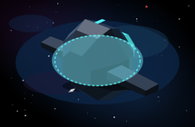

T'Khasi Orion, shields full, 8 markers, 140px:

Escape Pod three-quarter, shields full and empty. Empty keeps the `#55ffff` port and stripe, draws scars, and drops the bubble. One marker sits outside the fins:

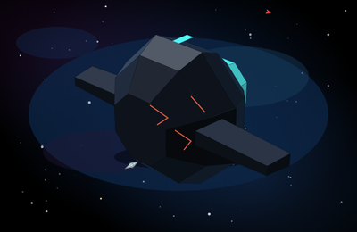

Escape Pod head-on and side. Head-on the cyan port is the face and the stub fins are the side masses. The side camera shows the same two fins on a short capsule, with one marker:

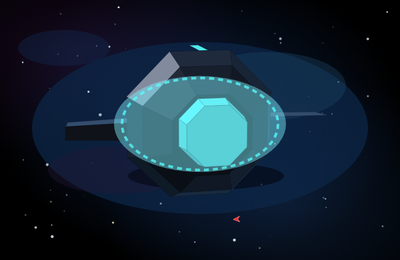

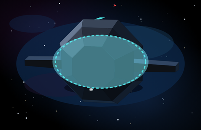

Escape Pod head-on, shields empty. The port stays `#55ffff`:

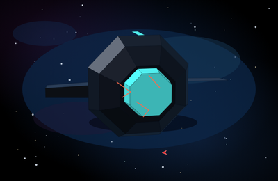

T'Khasi three-quarter, shields full and empty. Empty keeps the `#ff6d8a` plate edges and stripe. Eight markers sit outside the plate tips:

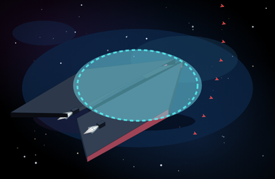

T'Khasi with a fitted TransWarp drive. The cones go magenta. The plate edges stay `#ff6d8a`:

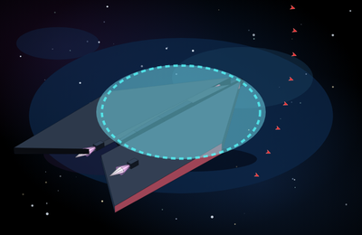

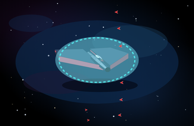

T'Khasi head-on, shields full and empty. The plate tips are the widest points, the core between them is thin, and the edges stay `#ff6d8a`. Two mouths sit low inside that span:

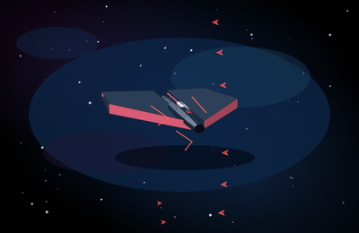

T'Khasi side. The plates are the silhouette, and both mouths show inside the plate span:

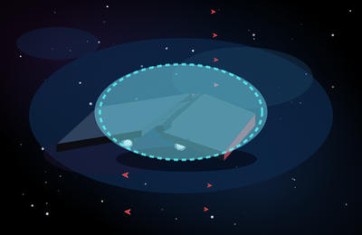

Hero crop, shields full, caps 1 and 8:

Hero crop, shields empty:

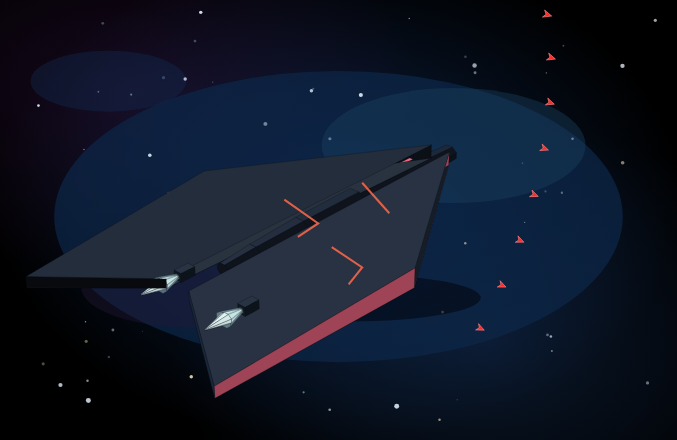

Phone fit `0.72`, same pose, full bays:

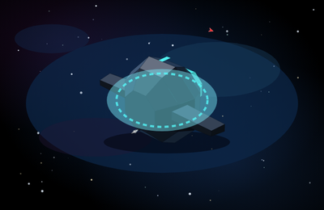

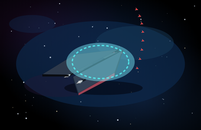

## Scout re-shot

The Scout faces are the cut-1 mesh. This cut does not move them. The pair frames put that needle beside the pod and beside the T'Khasi, at the base cap (2 markers, 150 fighters) and the live cap (3 markers, 250 fighters). The ring radius does not change between those caps.

Escape Pod beside the Scout, 140px, shields full. Scout at the base cap. The pod is the short finned capsule. The Scout stays the long needle:

Same pair, shields empty, so the cyan port and the mint canard edges both stay:

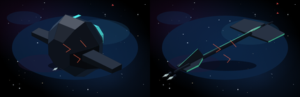

Scout at the live cap, 3 markers, beside the pod:

Head-on and side. The pod's face is the round port. The Scout's face is the canard cross:

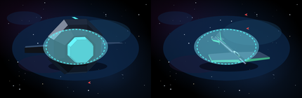

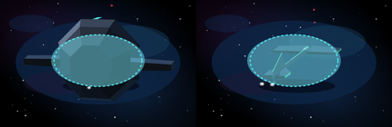

T'Khasi beside the Scout, 140px, shields full. Scout at the live cap. The plates are the crescent. The Scout stays the needle:

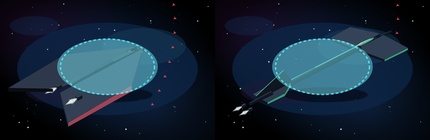

Scout at the base cap, beside the T'Khasi:

Same pair, shields empty. Plate edges stay `#ff6d8a`. Canard edges stay `#5dffc8`:

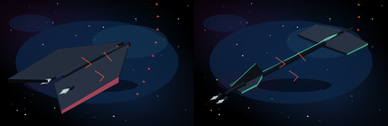

Head-on and side. The T'Khasi is the wide plate pair. The Scout is the thin cross:

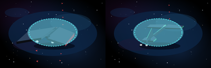

Hero crops of the two pair poses:

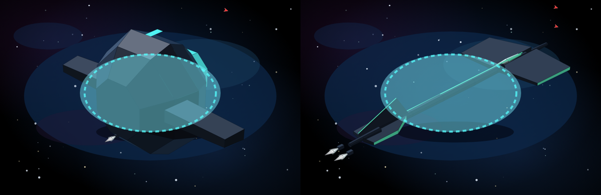

Head-on, the Escape Pod silhouette is 263 by 150. The T'Khasi silhouette is 152 by 50. The Scout silhouette is 163 by 90.

## Markers

`escortSlots` at the canonical pose, the phone fit, head-on, and the side clip. Every placed slot is outside the bounding sphere, kit included. Screen boxes do not hit the silhouette and do not clip the 400×260 frame.

| Case | Markers | Placed | Under / overlap / clipped |
| --- | --- | --- | --- |
| Either hull, bay 0 | 0 | 0 | 0 / 0 / 0 |
| Escape Pod, bay 1–50 | 1 | 1 | 0 / 0 / 0 |
| T'Khasi, bay 1–100 | 1 | 1 | 0 / 0 / 0 |
| T'Khasi, bay 750 | 8 | 8 | 0 / 0 / 0 |
| Scout, bay 150 (unchanged) | 2 | 2 | 0 / 0 / 0 |
| Scout, bay 250 (unchanged) | 3 | 3 | 0 / 0 / 0 |

Checked at fit `1.12` and `0.72` (yaw `0.82`, pitch `0.5`), head-on fit `1`, and side fit `1.15`. The fins set the sides of the pod sphere, and the capsule sets the top. The plates set the beam and the stern of the T'Khasi sphere. A bay of 749 is already 8, and the eighth dart is a partial hundred with no numeral. The cap 750 is that same count.

## Frame time

Node 22 on this VM. One `drawShipFrame`-shaped update: project every face, build the point string, and project each marker. Nine samples after four warmups. Median / max. Slot bake is the cost when the bay changes, not part of the frame.

| Frame | Fit | Markers | Bake | JS frame |
| --- | --- | --- | --- | --- |
| Escape Pod, canonical | 1.12 | 1 | 1.9 ms | 0.17 / 0.33 ms |
| T'Khasi, canonical | 1.12 | 8 | 2.1 ms | 0.25 / 0.45 ms |
| Scout, canonical | 1.12 | 3 | 3.5 ms | 0.27 / 0.38 ms |
| Imperial, drift-shaped | 0.76 | 500 | 6.2 ms | 1.94 / 2.73 ms |
| Imperial, static-shaped | 0.72 | 1,000 | 7.4 ms | 2.68 / 3.09 ms |

All five sit under the 16 ms bar, so the markers stay individual SVG paths. This bench is the projection work in Node. It does not include a browser layout.

## Shields 0

Accent fill, averaged over the same five cameras at damage 0 and damage 1, did not move. A fitted TransWarp drive did not move it either.

| Hull | Accent at damage 1 | Body at damage 1 | Idle plume | Fitted TransWarp plume |
| --- | --- | --- | --- | --- |
| Escape Pod | `[69, 207, 207]` cyan `#55ffff` | `[22, 31, 44]` | `[246, 255, 255]` | `[255, 211, 255]` |
| T'Khasi Orion | `[208, 89, 113]` rose `#ff6d8a` | `[44, 52, 66]` | `[246, 255, 255]` | `[255, 211, 255]` |

The fitted drive recolours the cones. The pod port and the T'Khasi plate edges stay the class accent, and those faces are flat metal (`accent` set, `emissive` clear). Scars draw. The bubble is absent at zero shields. Mint `#5dffc8` stays on the Scout.
