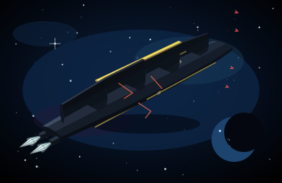
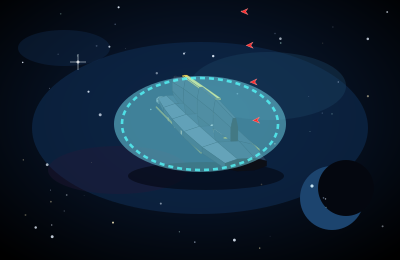
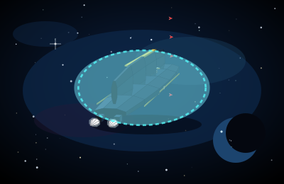
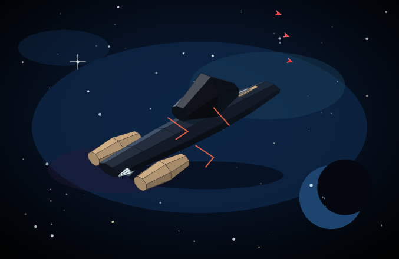
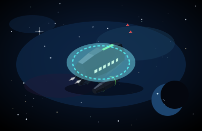
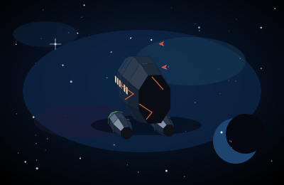
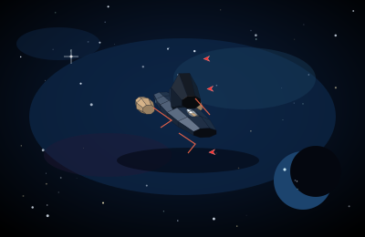

# P1b — CargoTran, Colonial Transport, and Taurean Mule

Parent: [batch 2 haulers](cockpit-ship-stage-p1b-batch2-haulers.md). Same path as the [P1 spike](cockpit-ship-stage-p1-spike.md) and the cuts already on `feature/grokbot-player`: `buildHullFaces` / `projectFace` in `web/hull-meshes.js`. No three.js. WebGL stays off. This sheet records the measured faces. It does not stamp Pass.

Stills for this sheet are listed in the [stills inventory](stills/README.md) (#344) under [p1b-batch2-haulers](stills/p1b-batch2-haulers/).

CargoTran (`cargotran`), Colonial Transport (`colonial_transport`), and Taurean Mule (`taurean_mule`) leave `fleet-glass-v1` on this wave. Merchant Cruiser, Imperial StarShip, Scout Marauder, Merchant Freighter, BattleShip, Corporate FlagShip, Escape Pod, and T'Khasi Orion stay on the faces they already had. The other six hulls stay on `fleet-glass-v1`.

Panel names stay `CargoTran`, `Colonial Transport`, and `Taurean Mule`. Accents are the panel `SHIPS` row. The `detail` string on all three stays `pods`. That token does not grow shoulder pods or Freighter cheeks: the face list is the same for `pods`, `bridge`, and an empty detail. Section token stays `box`. Marker counts use `max(1, ceil(n / 100))` when `n ≥ 1`. CargoTran cap 400 is 4 markers. Colonial cap 200 is 2. Taurean Mule cap 300 is 3. A partial last hundred has no numeral. The legend stays `each marker = 100 fighters`.

## Faces and size

| Hull | Faces | Accent faces | Bounding radius | Span (x × y × z) |
| --- | --- | --- | --- | --- |
| CargoTran | 212 | 28 | 88.2 | 170.1 × 22.8 × 25.6 |
| Colonial Transport | 251 | 51 | 54.3 | 89.7 × 53.8 × 42.0 |
| Taurean Mule | 209 | 47 | 52.3 | 100.0 × 27.9 × 36.6 |
| Merchant Freighter (unchanged) | 251 | 35 | 60.6 | 97.9 × 16.0 × 97.8 |
| Merchant Cruiser (unchanged) | 217 | 41 | 79.0 | 142.6 × 37.0 × 61.5 |
| Imperial StarShip (unchanged) | 311 | 71 | 116.9 | 216.5 × 57.3 × 51.1 |
| Scout Marauder (unchanged) | 201 | 23 | 92.0 | 178.6 × 20.0 × 64.0 |
| BattleShip (unchanged) | 226 | 13 | 67.0 | 113.3 × 31.4 × 81.3 |
| Corporate FlagShip (unchanged) | 210 | 7 | 78.0 | 139.2 × 44.2 × 44.3 |
| Escape Pod (unchanged) | 98 | 11 | 64.2 | 70.8 × 71.3 × 128.0 |
| T'Khasi Orion (unchanged) | 167 | 15 | 79.8 | 116.8 × 11.9 × 72.0 |

`web/hull-meshes.js` is 49,993 bytes raw and **12,659 bytes gzipped** (level 9). Budget is 40 KB gzipped.

The CargoTran is the long deck. Its length (170.1) is past the Freighter (97.9), and its beam (25.6) stays under a third of the Freighter's cheeks (97.8). A narrow girder runs most of the deck. The crest is the high point from the side and from head-on (`y = 18.5`, `|z| = 1.3`). The girder sides stay dark metal. The yellow edge is the top of that crest, and a yellow stripe runs the flank. The underside stops at `y = -4.3`, so there is no Merchant keel. Two bells sit low in the tail, inside the beam.

The Colonial is the tall cabin. Height (53.8) beats beam (42.0) and is more than three times the Freighter's height. Length (89.7) stays under the CargoTran. Two round tanks hang under the box and set the bottom (`y = -32.6`) and the head-on outer masses. Green rims sit on the tanks. The cabin and the tank bodies stay dark metal. A row of warm-white ports runs the flank. Two smaller bells sit in the tail, inboard of the tanks and above them.

The Mule is the low saddle. Height (27.9) stays under the Colonial. Beam (36.6) stays under half the Freighter and under the Mule's own length. One dark pack sits amidships (`x = 4`, `y = 21.6`) and stops short of the nose and the tail. Two tan panniers hang at the rear corners and set the outer tail. Two bells sit between the panniers. The flank has no cabin-port row. The pack stays dark metal.

Panel fit is unchanged: phone static `0.72`, 80 or more markers `0.76`, Imperial `0.84`, these three hulls `1.12`. At yaw `0.82` pitch `0.5` and fit `1.12`, every vertex of all three hulls lands inside the 400×260 view.

## Stills

Canonical pose is yaw `0.82`, pitch `0.5`. Head-on is clip camera `headon` (`yaw -1.35`, `pitch 0.2`). Side is clip camera `side` (`yaw 1.35`, `pitch 0.18`). Shields full draw the bubble. Shields empty drop the bubble, draw the scar strokes, and run damage `1` through `projectFace`. Accent faces skip that wash. No name plate is drawn.

`#shipSvg` shows this viewBox at `max-height: 140px`. The 140px stills are that frame (215×140). The hero stills are the same viewBox at 440px tall (677×440), about 55% of an 800px deck. Phone, `prefers-reduced-motion`, and `body.cu-seat` hold this pose and do not loop. The phone still uses fit `0.72`. This wave does not edit `web/redesign.css`.

CargoTran, shields full, 4 markers, 140px:

Colonial Transport, shields full, 2 markers, 140px:

Taurean Mule, shields full, 3 markers, 140px:

CargoTran three-quarter, shields full and empty. Empty keeps the `#ffe566` spine edge and flank stripe, draws scars, and drops the bubble. Four markers sit outside the girder:

CargoTran head-on and side. Head-on the ridge is the high point and the two mouths sit low inside the beam. The side camera shows the same girder on a long deck:

Colonial three-quarter, shields full and empty. Empty keeps the `#7dff7d` tank rims and stripe. The port row stays warm white. Two markers sit outside the box:

Colonial head-on and side. Head-on the face is tall, the tanks are the low outer masses, and the mouths sit inside that span. The side camera shows both tanks under the cabin:

Taurean Mule three-quarter, shields full and empty. Empty keeps the `#d7b48a` panniers and stripe. The pack stays dark. Three markers sit outside the hump:

Taurean Mule head-on and side. Head-on the pack is the centerline bump. The side camera shows the hump stopping short of the nose and the tail, with the panniers at the stern:

Hero crop, shields full, caps 4, 2, and 3:

Hero crop, shields empty:

Phone fit `0.72`, same pose, full bays:

Head-on, shields empty. The spine edge stays `#ffe566`, the tank rims stay `#7dff7d`, and the panniers stay `#d7b48a`:

## Markers

`escortSlots` at the canonical pose, the phone fit, head-on, and the side clip. Every placed slot is outside the bounding sphere, kit included. Screen boxes do not hit the silhouette and do not clip the 400×260 frame.

| Case | Markers | Placed | Under / overlap / clipped |
| --- | --- | --- | --- |
| Any of the three, bay 0 | 0 | 0 | 0 / 0 / 0 |
| Any of the three, bay 1–100 | 1 | 1 | 0 / 0 / 0 |
| Colonial, bay 200 | 2 | 2 | 0 / 0 / 0 |
| Taurean Mule, bay 300 | 3 | 3 | 0 / 0 / 0 |
| CargoTran, bay 400 | 4 | 4 | 0 / 0 / 0 |

Checked at fit `1.12` and `0.72` (yaw `0.82`, pitch `0.5`), head-on fit `1`, and side fit `1.15`. The girder sets the top of the CargoTran sphere. The tanks set the bottom of the Colonial sphere and the cabin sets the top. The hump sets the top of the Mule sphere and the panniers set the tail corners.

## Frame time

Node 22 on this VM. One `drawShipFrame`-shaped update: project every face, build the point string, and project each marker. Nine samples after four warmups. Median / max. Slot bake is one sample, the cost when the bay changes, not part of the frame.

| Frame | Fit | Markers | Bake | JS frame |
| --- | --- | --- | --- | --- |
| CargoTran, canonical | 1.12 | 4 | 6.3 ms | 0.67 / 1.34 ms |
| Colonial, canonical | 1.12 | 2 | 4.2 ms | 0.89 / 1.51 ms |
| Taurean Mule, canonical | 1.12 | 3 | 8.0 ms | 0.36 / 0.79 ms |
| Imperial, drift-shaped | 0.76 | 500 | 10.2 ms | 0.66 / 0.94 ms |
| Imperial, static-shaped | 0.72 | 1,000 | 6.3 ms | 0.60 / 0.76 ms |

All five sit under the 16 ms bar, so the markers stay individual SVG paths. This bench is the projection work in Node. It does not include a browser layout.

## Shields 0

Accent fill, averaged over the same five cameras at damage 0 and damage 1, did not move. A fitted TransWarp drive did not move it either. Idle cones are cyan-white. A fitted drive turns the cones magenta and leaves the accent where it was.

| Hull | Accent at damage 1 | Body at damage 1 | Idle plume | Fitted TransWarp plume |
| --- | --- | --- | --- | --- |
| CargoTran | `[206, 185, 82]` yellow `#ffe566` | `[40, 51, 63]` | `[246, 255, 255]` | `[255, 211, 255]` |
| Colonial Transport | `[102, 208, 102]` green `#7dff7d` | `[39, 51, 64]` | `[246, 255, 255]` | `[255, 211, 255]` |
| Taurean Mule | `[176, 147, 113]` tan `#d7b48a` | `[44, 54, 67]` | `[246, 255, 255]` | `[255, 211, 255]` |

The fitted drive recolours the cones. The spine edge, the tank rims, and the panniers stay the class accent, and those faces are flat metal (`accent` set, `emissive` clear). Scars draw. The bubble is absent at zero shields. The body stays dark blue-grey.
