# P1b — Missile Frigate and Havoc GunStar

Parent: [batch 3 guns](cockpit-ship-stage-p1b-batch3.md). Read-test: [batch 3 acceptance](cockpit-ship-stage-p1b-batch3-acceptance.md). Gate: [batch 3 readiness](cockpit-ship-stage-p1b-batch3-readiness.md) (#333). Stills directory: [p1b-batch3-guns](stills/p1b-batch3-guns/). The stills index is [stills/README.md](stills/README.md) (#344). Same path as the [P1 spike](cockpit-ship-stage-p1-spike.md) and the cuts already on `feature/grokbot-player`: `buildHullFaces` / `projectFace` in `web/hull-meshes.js`. No three.js. WebGL stays off. This sheet records the measured faces. It does not stamp Pass.

Missile Frigate (`missile_frigate`) and Havoc GunStar (`havoc_gunstar`) leave `fleet-glass-v1` on this wave. Merchant Cruiser, Imperial StarShip, Scout Marauder, Merchant Freighter, BattleShip, Corporate FlagShip, Escape Pod, T'Khasi Orion, CargoTran, Colonial Transport, and Taurean Mule stay on the faces they already had. Star Master, Constellation, Tholian Sentinel, and Interdictor Cruiser stay on `fleet-glass-v1`. The BattleShip is re-shot beside these two. Its faces are not recut.

Panel names stay `Missile Frigate` and `Havoc GunStar`. Accents are the panel `SHIPS` row: `#ffb15a` and `#ff8844`. The Frigate `detail` string stays `rails bridge`. The Havoc `detail` string stays `guns bridge`. Those tokens do not change the face list: the hash is the same for `rails`, `bridge`, `guns`, `pods`, an empty detail, `photon_missiles` 10, and a holo scanner. Section token stays `round` on the Frigate and `hex` on the Havoc. Marker counts use `max(1, ceil(n / 100))` when `n ≥ 1`. Frigate cap 5,000 is 50 markers. Havoc cap 10,000 is 100. A partial last hundred has no numeral. The legend stays `each marker = 100 fighters`.

## Faces and size

| Hull | Faces | Accent faces | Bounding radius | Span (x × y × z) |
| --- | --- | --- | --- | --- |
| Missile Frigate | 283 | 111 | 118.1 | 208.3 × 20.0 × 24.6 |
| Havoc GunStar | 261 | 47 | 61.3 | 118.7 × 15.1 × 22.9 |
| BattleShip (unchanged) | 226 | 13 | 67.0 | 113.3 × 31.4 × 81.3 |
| Imperial StarShip (unchanged) | 311 | 71 | 116.9 | 216.5 × 57.3 × 51.1 |
| Merchant Cruiser (unchanged) | 217 | 41 | 79.0 | 142.6 × 37.0 × 61.5 |
| Scout Marauder (unchanged) | 201 | 23 | 92.0 | 178.6 × 20.0 × 64.0 |
| Merchant Freighter (unchanged) | 251 | 35 | 60.6 | 97.9 × 16.0 × 97.8 |
| Corporate FlagShip (unchanged) | 210 | 7 | 78.0 | 139.2 × 44.2 × 44.3 |
| CargoTran (unchanged) | 212 | 28 | 88.2 | 170.1 × 22.8 × 25.6 |

`web/hull-meshes.js` is 53,581 bytes raw and **13,507 bytes gzipped** (Python `gzip.compress`, level 9, the same call `tests/test_cockpit_ship_stage_p1.py` uses). Budget is 40 KB gzipped.

The Frigate is the photon boat. Length (208.3) stays under the Imperial (216.5) and past the BattleShip (113.3). Beam (24.6) stays under two fifths of the BattleShip beam (81.3). One fuselage nose leads the missile tips: the nose reaches `x = 118` and the missile tips stop at `x = 94`. Two dorsal missiles sit on thin rails. Each missile body spans 74 × 6.7, against a canopy of 20 × 3.1, so the body is longer and taller than the canopy. BattleShip turret barrels span 1.7 on y, so these bodies are the thicker pair. The rail metal is 78 long and 1.2 tall, under the pair and short of the deck, so it is a track and not a CargoTran girder. Missile bodies fill near `#ffb15a` (`[203, 141, 72]`). Noses fill hotter (`[202, 59, 14]`). Two bells sit low in the tail (`y = -3.4`), inside the beam. A loaded photon count of 10 does not add a third body.

The Havoc is the short forked gunship. Length (118.7) stays under the Imperial. Beam (22.9) and height (15.1) stay under the BattleShip wedge (81.3 × 31.4). Prong tips reach `x = 58`. The loft nose stops at `x = 30`, so the tips lead the nose by 28. Shafts stay dark metal. Tips and the stripe are `#ff8844`. Three bells sit in a low row in the tail (`y = -5.2`, `z = -6.4, 0, 6.4`), inside the hex and behind the prong line. The head-on gap between the tips holds no marker on the three-quarter, head-on, or side cameras.

Panel fit is unchanged: phone static `0.72`, 80 or more markers `0.76`, Imperial `0.84`, the Frigate `1.12`. The Havoc cap is 100 markers, so the panel uses `0.76`. These stills draw the Havoc at `1.12`, the same fit the BattleShip stills use, and that ring clears. At yaw `0.82` pitch `0.5` and fit `1.12`, every vertex of both new hulls lands inside the 400×260 view. The Imperial at `1.12` leaves that view, so the Imperial re-shot uses its panel fit `0.84`.

## Stills

Canonical pose is yaw `0.82`, pitch `0.5`. Head-on is clip camera `headon` (`yaw -1.35`, `pitch 0.2`). Side is clip camera `side` (`yaw 1.35`, `pitch 0.18`). Shields full draw the bubble. Shields empty drop the bubble, draw the scar strokes, and run damage `1` through `projectFace`. Accent faces skip that wash. No name plate is drawn.

`#shipSvg` shows this viewBox at `max-height: 140px`. The 140px stills are that frame (215×140). The hero stills are the same viewBox at 440px tall (677×440), about 55% of an 800px deck. Pair frames are two of those side by side (430×140 and 1354×440). Phone, `prefers-reduced-motion`, and `body.cu-seat` hold this pose and do not loop. The phone still uses fit `0.72`. This wave does not edit `web/redesign.css`.

Marker counts on these frames: Frigate 50, Havoc 100, BattleShip 100, CargoTran 4, Scout 3, Freighter 3. The Imperial re-shot uses 25 markers so the castle and the square of bells stay readable at 140px. The 500-marker and 1,000-marker cases are the frame-time rows below. The FlagShip re-shot uses 8 markers and the Star Master re-shot uses 8, so the centerline rectangle and the mast stay readable. Those three meshes are not recut. Star Master stays on `fleet-glass-v1`.

Missile Frigate, shields full, 50 markers, 140px:

Missile Frigate, shields empty, 140px. The `#ffb15a` bodies and the hotter noses stay. Scars draw. The bubble is gone:

Havoc GunStar, shields full, 100 markers, 140px:

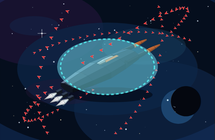

Havoc GunStar, shields empty, 140px. The `#ff8844` tips stay:

Havoc GunStar, fitted TransWarp, 140px. The cones go magenta. The tips stay `#ff8844`:

Missile Frigate three-quarter, shields full and empty. Fifty markers sit outside the missiles:

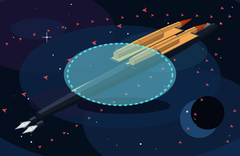

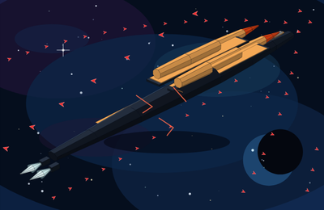

Missile Frigate head-on and side. Head-on is two missile bodies above one slim nose. The side camera shows the same pair on the rail, noses short of the fuselage nose, and two mouths low in the tail:

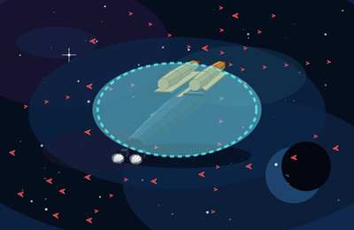

Head-on hero crop, shields full and empty:

Havoc three-quarter, shields full, empty, and fitted. One hundred markers sit outside the prongs. The gap stays empty:

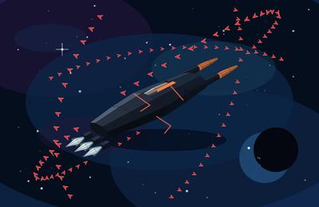

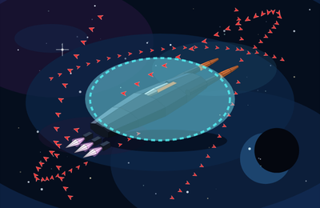

Havoc head-on and side. Head-on is two `#ff8844` tips with a gap, and three mouths in a low row. Idle cones are cyan-white. Fitted cones are magenta. The side camera shows the tips past the loft nose:

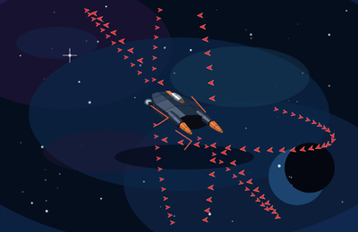

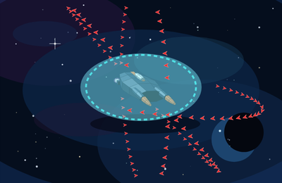

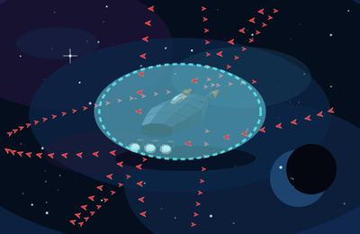

Head-on hero crop, shields full, empty, and fitted:

Hero crop, shields full:

Hero crop, shields empty:

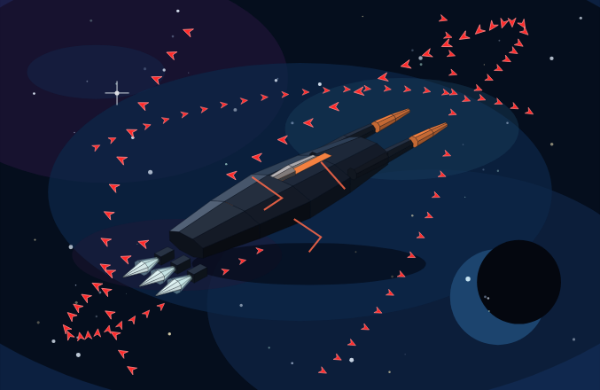

Phone fit `0.72`, same pose, full bays:

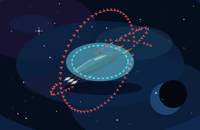

## Re-shots and wave read

Left hull is the first name in the [wave read](cockpit-ship-stage-p1b-batch3.md#wave-read-test). BattleShip faces stay the cut-2 mesh. Imperial faces stay the P1 mesh.

Frigate beside the Imperial, 140px, shields full. Missiles on a slim spine versus the castle and the square of bells. The Imperial forward barrels stay the smaller pair:

Same pair, shields empty:

Hero, shields full and empty:

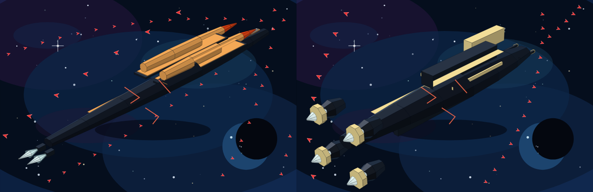

Head-on, 140px, shields full and empty:

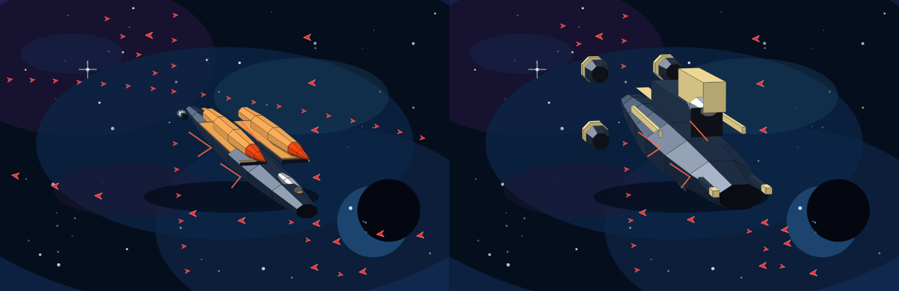

Frigate beside the BattleShip. Missiles on a rail versus thinner barrels on a turret pair, on a wide hex wedge:

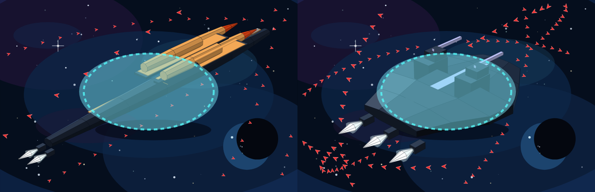

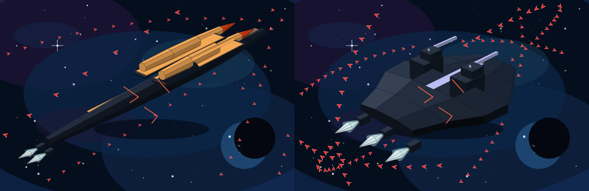

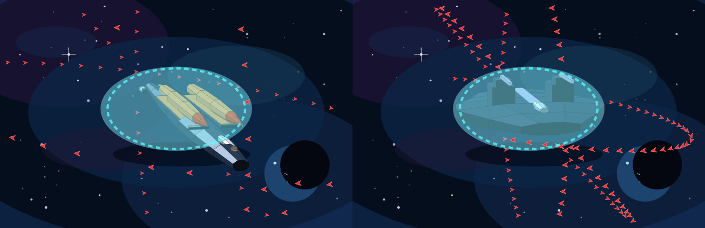

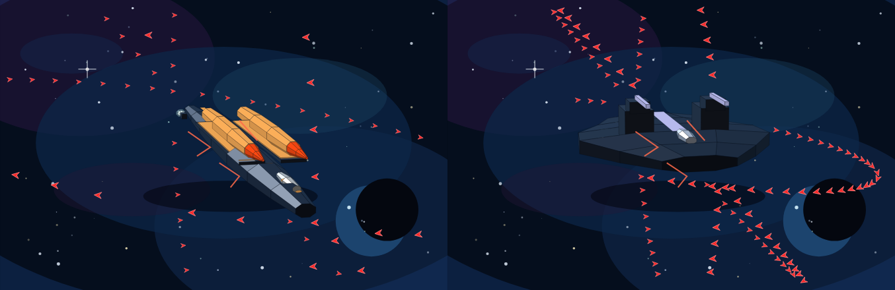

Havoc beside the BattleShip. Prongs ahead of a short body versus turrets on the back of a wide wedge. No prongs grow on the BattleShip nose:

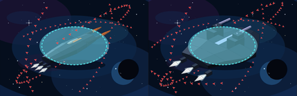

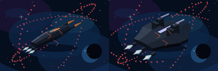

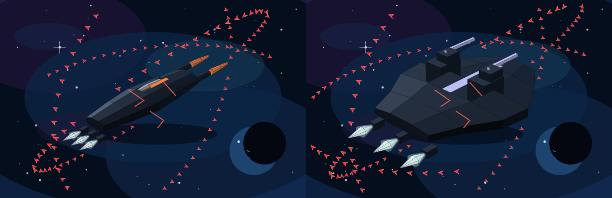

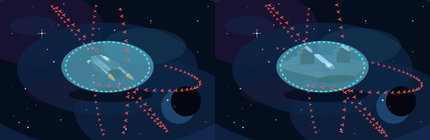

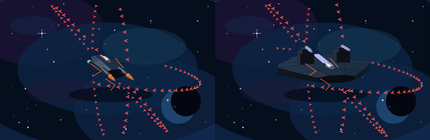

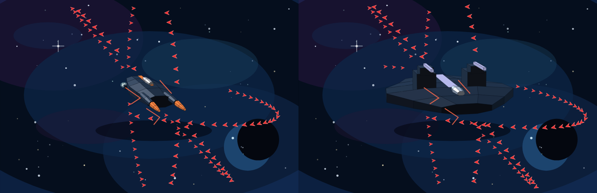

Frigate beside the Havoc. One nose and a dorsal pair versus two prongs with a gap:

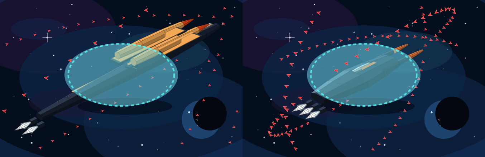

Frigate beside the CargoTran. Two missile bodies on a thin rail versus a girder the length of a flat deck:

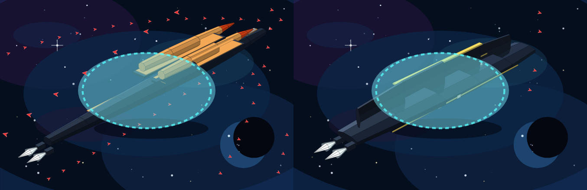

Frigate beside the Scout. A photon boat versus a needle and canards:

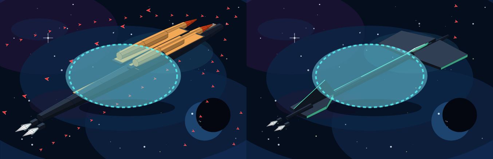

Havoc beside the Imperial. Prongs ahead of a short body versus a long castle and a square of bells:

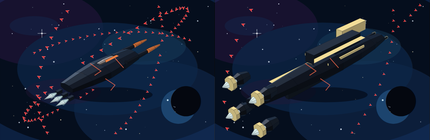

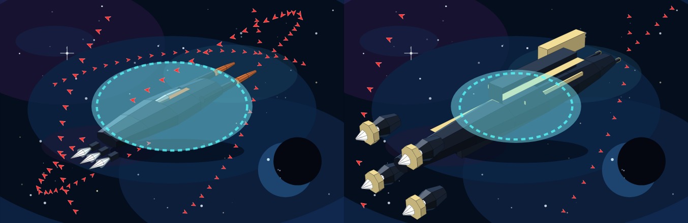

Havoc beside the Freighter. Two prong tips and a gap versus a short broad cheek face:

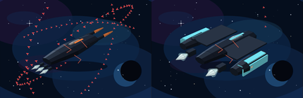

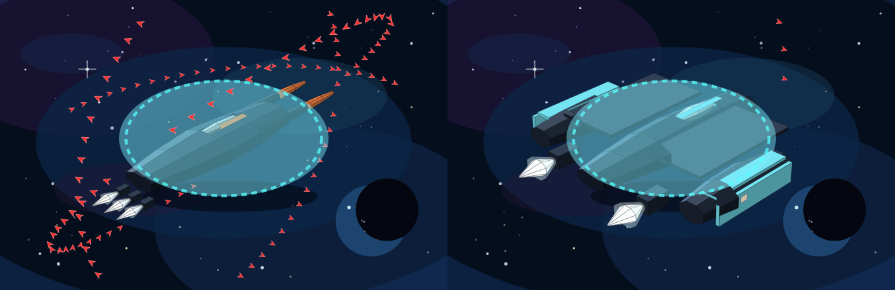

Havoc beside the FlagShip. A gap between prongs versus a tower rectangle on the centerline. The FlagShip is not recut:

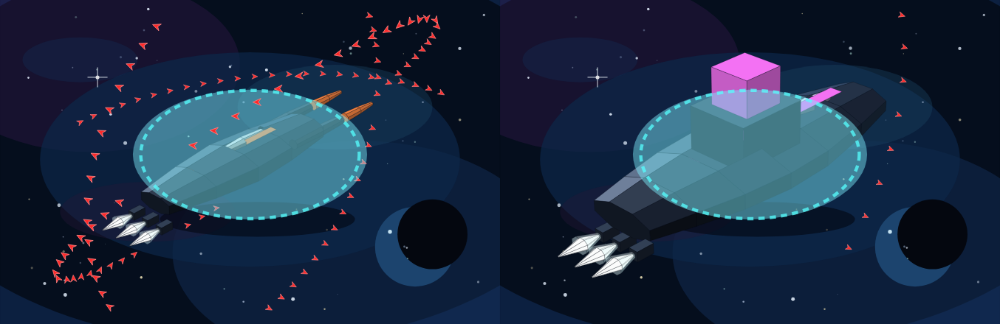

Havoc beside the Star Master. Prongs versus a dish on a mast. The Star Master stays on `fleet-glass-v1`. No mast grows on the Havoc:

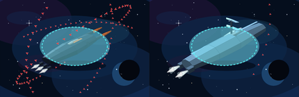

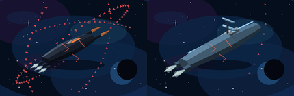

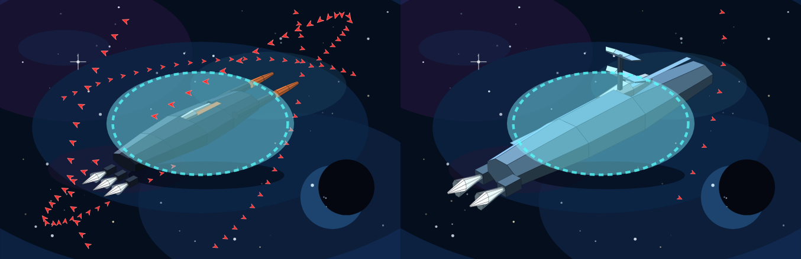

## Markers

`escortSlots` at the canonical pose, the phone fit, the Havoc panel fit, head-on, and the side clip. Every placed slot is outside the bounding sphere, kit included. Screen boxes do not hit the silhouette and do not clip the 400×260 frame. No marker sits in the Havoc tip span.

| Case | Markers | Placed | Under / overlap / clipped |
| --- | --- | --- | --- |
| Either hull, bay 0 | 0 | 0 | 0 / 0 / 0 |
| Either hull, bay 1–100 | 1 | 1 | 0 / 0 / 0 |
| Frigate, bay 5,000 | 50 | 50 | 0 / 0 / 0 |
| Havoc, bay 10,000 | 100 | 100 | 0 / 0 / 0 |

Checked at fit `1.12` and `0.72` (yaw `0.82`, pitch `0.5`), Havoc panel fit `0.76`, head-on fit `1`, and side fit `1.15`. The missiles set the top of the Frigate sphere. The prong tips set the nose of the Havoc sphere. The test also checks the partial-hundred rows: 4,900 is 49, 4,901 through 5,000 is 50, 9,900 is 99, and 9,901 through 10,000 is 100. No numeral is drawn on a dart.

## Frame time

Node 22.23.4 on this VM. One `drawShipFrame`-shaped update: project every face, build the point string, and project each marker. Nine samples after four warmups. Median / max. Slot bake is one sample, the cost when the bay changes, not part of the frame.

| Frame | Fit | Markers | Bake | JS frame |
| --- | --- | --- | --- | --- |
| Missile Frigate, canonical | 1.12 | 50 | 6.1 ms | 0.79 / 1.24 ms |
| Havoc GunStar, canonical | 1.12 | 100 | 2.0 ms | 0.35 / 0.44 ms |
| Havoc GunStar, panel | 0.76 | 100 | 2.1 ms | 0.70 / 0.93 ms |
| Imperial, drift-shaped | 0.76 | 500 | 7.6 ms | 0.62 / 0.86 ms |
| Imperial, static-shaped | 0.72 | 1,000 | 6.6 ms | 0.67 / 1.00 ms |

All five sit under the 16 ms bar, so the markers stay individual SVG paths. This bench is the projection work in Node. It does not include a browser layout.

## Shields 0

Accent fill, averaged over the same five cameras at damage 0 and damage 1, did not move. A fitted TransWarp drive did not move it either. The Frigate average mixes the `#ffb15a` bodies with the hotter noses, so the row is darker than the body fill alone. Idle cones are cyan-white. A fitted drive turns the cones magenta and leaves the accent where it was. The Frigate is not on `SHIP_TW_CHART_RANGE`. Its pass pose is the idle cones. The Havoc is on that chart (16 hops). Its pass pose includes the drive pair.

| Hull | Accent at damage 0 and 1 | Body at damage 1 | Idle plume | Fitted TransWarp plume |
| --- | --- | --- | --- | --- |
| Missile Frigate | `[204, 116, 54]` (bodies `[203, 141, 72]`, noses `[202, 59, 14]`) | `[44, 54, 67]` | `[246, 255, 255]` | `[255, 211, 255]` |
| Havoc GunStar | `[206, 110, 55]` `#ff8844`, including with a drive fitted | `[41, 50, 64]` | `[246, 255, 255]` | `[255, 211, 255]` |

The fitted drive recolours the cones. Missile bodies, rail edges, prong tips, and stripes stay flat metal (`accent` set, `emissive` clear). Scars draw. The bubble is absent at zero shields. The body stays dark blue-grey.

## Checklist notes

Recorded against the batch-3 contract. This sheet does not stamp Pass.

- Both hulls are on `buildHullFaces` / `projectFace`. `frigateSpike` and `havocSpike` early-return out of `fleet-glass-v1`. No `three` import and no WebGL context in `web/hull-meshes.js`.
- Frigate reads as one nose, two dorsal missiles larger than the canopy, a short rail, and two low engines. Havoc reads as two prongs past the loft nose, dark shafts, orange tips, an empty gap, and three low engines.
- BattleShip stays 226 faces. Imperial stays 311. Merchant stays 217. The re-shots are the pair stills above.
- Shields empty keeps `#ffb15a` (and the hotter noses) and `#ff8844`. Havoc tips stay that colour when the cones go magenta.
- Marker formula, the 50 and 100 caps, and clearance are pinned in `tests/test_cockpit_ship_stage_p1b_batch3_guns.py`. The 200-cap legend stays retired. `fleet-glass-v1` pins for these two hulls moved out of `FLEET_GLASS` in the same change. Pins for hulls this wave does not cut stay.
- Gzip 13,507 bytes, under 40 KB. The five frame rows above sit under 16 ms.
- Phone, reduced motion, and `body.cu-seat` are the canonical three-quarter still. No separate loop.
- No engine change, no new action, no new event field. `web/redesign.js` and `web/redesign.css` are untouched. Star Master and Constellation are not started.
