# P1b — Star Master and Constellation

Parent: [batch 4 dish and X](cockpit-ship-stage-p1b-batch4.md). Read-test: [batch 4 acceptance](cockpit-ship-stage-p1b-batch4-acceptance.md). Gate: [batch 4 readiness](cockpit-ship-stage-p1b-batch4-readiness.md) (#334). Stills directory: [p1b-batch4-dish](stills/p1b-batch4-dish/). The stills index is [stills/README.md](stills/README.md). Same path as the [P1 spike](cockpit-ship-stage-p1-spike.md) and the cuts already on `feature/grokbot-player`: `buildHullFaces` / `projectFace` in `web/hull-meshes.js`. No three.js. WebGL stays off. This sheet records the measured faces. It does not stamp Pass.

Star Master (`star_master`) and Constellation (`constellation`) leave `fleet-glass-v1` on this wave. Merchant Cruiser, Imperial StarShip, Scout Marauder, Merchant Freighter, BattleShip, Corporate FlagShip, Escape Pod, T'Khasi Orion, CargoTran, Colonial Transport, Taurean Mule, Missile Frigate, and Havoc GunStar stay on the faces they already had. Tholian Sentinel and Interdictor Cruiser stay on `fleet-glass-v1`. The FlagShip and the Imperial are re-shot beside the dish and beside the X. Their faces are not recut.

Panel names stay `Star Master` and `Constellation`. Accents are the panel rows: `#9ad7ff` on the plate and the stripe, `#d0d6ff` on the nacelles and the stripe. The Star Master `detail` string stays `dish bridge`. The Constellation `detail` string stays `nacelles bridge`. Those tokens do not change the face list. A holo scanner, a density scanner, `photon_missiles` 10, and an engine-count swap hash the same points. Section token stays `round` on both, and on the FlagShip. Marker counts use `max(1, ceil(n / 100))` when `n ≥ 1`. Each new cap of 5,000 is 50 markers. A partial last hundred has no numeral. The legend stays `each marker = 100 fighters`.

## Faces and size

| Hull | Faces | Accent faces | Bounding radius | Span (x × y × z) |
| --- | --- | --- | --- | --- |
| Star Master | 183 | 29 | 44.1 | 71.9 × 31.4 × 44.0 |
| Constellation | 311 | 91 | 64.0 | 100.7 × 40.9 × 42.3 |
| Corporate FlagShip (unchanged) | 210 | 7 | 78.0 | 139.2 × 44.2 × 44.3 |
| Imperial StarShip (unchanged) | 311 | 71 | 116.9 | 216.5 × 57.3 × 51.1 |
| BattleShip (unchanged) | 226 | 13 | 67.0 | 113.3 × 31.4 × 81.3 |
| Havoc GunStar (unchanged) | 261 | 47 | 61.3 | 118.7 × 15.1 × 22.9 |
| Merchant Cruiser (unchanged) | 217 | — | — | prior pin |
| Scout Marauder (unchanged) | 201 | — | — | prior pin |
| Merchant Freighter (unchanged) | 251 | — | — | prior pin |
| Escape Pod (unchanged) | 98 | — | — | prior pin |
| T'Khasi Orion (unchanged) | 167 | — | — | prior pin |
| CargoTran (unchanged) | 212 | — | — | prior pin |
| Colonial Transport (unchanged) | 251 | — | — | prior pin |
| Taurean Mule (unchanged) | 209 | — | — | prior pin |
| Missile Frigate (unchanged) | 283 | — | — | prior pin |

`web/hull-meshes.js` is 59,190 bytes raw and **14,991 bytes gzipped** (Python `gzip.compress`, level 9, the same call `tests/test_cockpit_ship_stage_p1.py` uses). Budget is 40 KB gzipped.

The Star Master is the dish. Length (71.9) stays under the Imperial (216.5). Height (31.4) stays under the FlagShip tower (44.2). The plate is a 16-gon, radius 22, thickness 0.84, span 44.0 × 0.8 × 44.0, so the top view is a circle. That span is wider than the fuselage beam (10.4). The mast is a 1.6 × 1.6 dark-metal column from the fuselage up to the plate. Two bells sit at `y = -2.6`, `z = ±3.1`, inside that beam and under the dish line. Point hash `7c79af13cc74372b`. Accent faces are not emissive.

The Constellation is the X. Length (100.7) stays under the Imperial. Height (40.9) stays under the FlagShip. Beam (42.3) stays under the BattleShip beam minus 30 (51.3). The nose reaches `x = 42`. The nacelle tips reach `x = -58.7`, past the tail. The arms reach 28.5 from the axis. The fuselage stays inside 5.4. Four mouths sit on the arms at `x = -36.6`, `y = ±12.8`, `z = ±14.2`, inside the X and off the centerline. No accent face sits where a dorsal plate would. Point hash `787b41d482d6501a`. Accent faces are not emissive.

Panel fit is unchanged: phone static `0.72`, 80 or more markers `0.76`, Imperial `0.84`, other hulls `1.12`. Both new caps are 50 markers, so these stills use `1.12`. At yaw `0.82` pitch `0.5` and fit `1.12`, the Star Master vertices land in the box (119.1, 43.7)–(253.3, 171.5) and the Constellation vertices land in (59.3, 86.9)–(268.2, 239.3), both inside the 400×260 view. The FlagShip re-shot uses `0.76` with 200 markers. The Imperial re-shot uses `0.84` with 25 markers so the castle and the square of bells stay readable.

## Stills

Canonical pose is yaw `0.82`, pitch `0.5`. Head-on is clip camera `headon` (yaw `-1.35`, pitch `0.2`). Side is clip camera `side` (yaw `1.35`, pitch `0.18`). Shields full draw the bubble. Shields empty drop the bubble, draw the scar strokes, and run damage `1` through `projectFace`. Accent faces skip that wash. No name plate is drawn.

`#shipSvg` shows this viewBox at `max-height: 140px`. The 140px singles are 215×140. The canonical singles are 400×260. The hero singles are 677×440. Pair frames are two cells side by side: 430×140 and 1354×440. Phone, `prefers-reduced-motion`, and `body.cu-seat` hold this pose and do not loop. The phone still is 400×260 at fit `0.72`. This wave does not edit `web/redesign.css`.

Marker counts on these frames: Star Master 50, Constellation 50, FlagShip 200, Havoc 100, BattleShip 100. The Imperial re-shot uses 25 markers so the castle stays readable at 140px. The 500-marker and 1,000-marker cases are the frame-time rows below. Neither new hull is on `SHIP_TW_CHART_RANGE`. Pass pose is idle cyan-white cones. The FlagShip drive pair is the re-shot.

Star Master, shields full, 50 markers, 140px. One plate on a stick, wider than the beam:

Star Master, shields empty, 140px. The plate stays `#9ad7ff`. Scars draw. The bubble is gone:

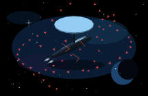

Constellation, shields full, 50 markers, 140px. Four nacelles in an X:

Constellation, shields empty, 140px. The nacelles stay `#d0d6ff`:

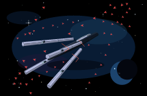

Star Master three-quarter, head-on, and side. Head-on is one plate wider than the beam and two mouths low inside it. The side camera shows the plate breaking the top edge:

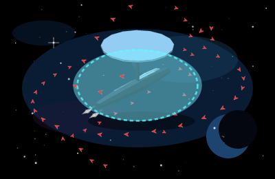

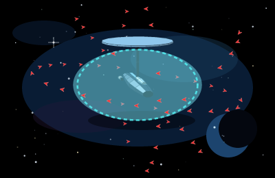

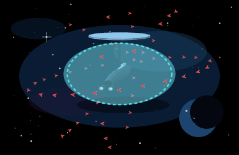

Constellation three-quarter, head-on, and side. Head-on is an X and little else. The side camera shows the arms trailing past the tail, with an empty gap between them:

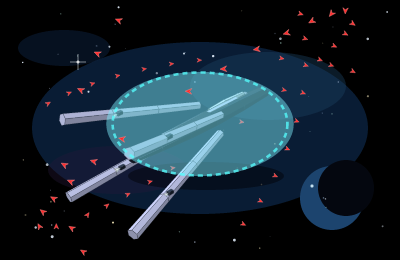

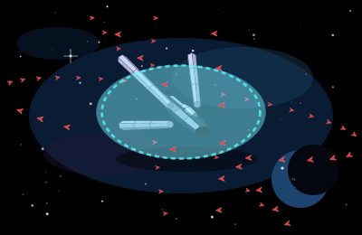

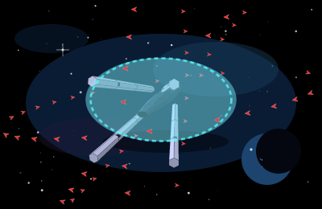

Hero crops, shields full. The plate is a circle on a stick. The X trails past the tail:

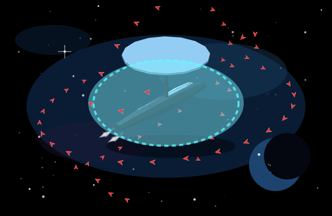

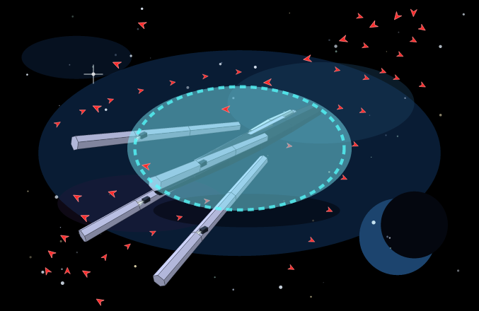

A plate on a mast beside an X of four nacelles, 140px:

The dish beside the FlagShip tower. Drive off, then drive on. The upper step stays flat `#ff77ff`. The cones go magenta only in the second frame:

The X beside the Imperial. The arms stay an X. The Imperial stays the long castle:

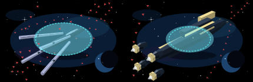

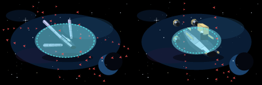

Every file under `docs/plans/stills/p1b-batch4-dish/` is shot. Singles are 215×140, 400×260, or 677×440. Pairs are 430×140 or 1354×440. The phone stills are the 400×260 frame at fit `0.72`.

| File | Pixels | Shot |
| --- | --- | --- |
| `sm-3q-full-140.png`, `sm-3q-empty-140.png` | 215×140 | Shields full, shields 0, 50 markers |
| `sm-3q-full.png`, `sm-3q-empty.png`, `sm-head.png`, `sm-head-empty.png`, `sm-side.png`, `sm-phone.png` | 400×260 | Three-quarter, head-on, side, phone fit `0.72` |
| `sm-3q-full-hero.png`, `sm-3q-empty-hero.png` | 677×440 | Hero, shields full and shields 0 |
| `con-3q-full-140.png`, `con-3q-empty-140.png` | 215×140 | Shields full, shields 0, 50 markers |
| `con-3q-full.png`, `con-3q-empty.png`, `con-head.png`, `con-head-empty.png`, `con-side.png`, `con-phone.png` | 400×260 | Three-quarter, head-on, side, phone fit `0.72` |
| `con-3q-full-hero.png`, `con-3q-empty-hero.png` | 677×440 | Hero, shields full and shields 0 |
| `pair-sm-fs-*` | 430×140, hero 1354×440 | Dish beside the tower, drive off and on, shields full and 0, head-on and side |
| `pair-fs-imp-*` | 430×140, hero 1354×440 | Tower beside the castle, same drive pair |
| `pair-sm-imp-*`, `pair-con-imp-*`, `pair-sm-con-*` | 430×140, hero 1354×440 | Dish beside the castle, X beside the castle, dish beside the X |
| `pair-fs-con-*` | 430×140, hero 1354×440 | Tower beside the X, drive off |
| `pair-sm-hv-*`, `pair-con-bs-*`, `pair-con-hv-*` | 430×140, hero 1354×440 | Dish beside the prongs, X beside the wedge, X beside the prongs |

## Dish and X tells

Cover the name plate. These reads hold on the stills above, at 140px and at the hero crop, shields 0 and shields full.

| Tell | Where it reads |
| --- | --- |
| One plate on one mast, wider than the beam. The top view is a circle on a stick | `sm-3q-full.png`, `sm-3q-empty.png`, `sm-head.png`, `sm-side.png`, hero and 140px |
| Two engines sit low, inside the beam, under the dish line | `sm-head.png`, `sm-side.png`. Mouths at `y = -2.6`, `z = ±3.1`, beam 10.4 |
| Plate and stripe stay `#9ad7ff` at shields 0. The mast stays dark metal | `sm-3q-empty.png`, `sm-head-empty.png`. Accent average `[121, 169, 200]` at damage 0 and 1 |
| Markers sit outside the plate. None ring the mast | Cap 50. Mast tube (`y < 26` and radius under 20) holds 0 slots |
| Four nacelles in an X trail past the tail. The gap between the arms is empty | `con-3q-full.png`, `con-head.png`, `con-side.png`, hero and 140px. Tips at `x = -58.7` |
| Four mouths sit off the centerline. The X is the larger cross | `con-head.png`. Mouths at `y = ±12.8`, `z = ±14.2`, inside arm radius 28.5 |
| Nacelles and stripe stay `#d0d6ff` at shields 0. The fuselage stays dark metal | `con-3q-empty.png`, `con-head-empty.png`. Accent average `[168, 173, 206]` |
| Markers sit outside the nacelle tips. None sit in the crook | Cap 50. Aft keel tube (`x` in (-60, 8) and radius under 14) holds 0 slots |
| A plate on a mast versus an X | `pair-sm-con-3q-140.png`, `pair-sm-con-3q-hero.png` |
| A dish versus a tower versus a long castle | `pair-sm-fs-3q-140.png`, `pair-sm-imp-3q-140.png` |
| An X versus a square of bells | `pair-con-imp-3q-140.png`, `pair-con-imp-head-140.png` |
| An X versus a tower rectangle | `pair-fs-con-3q-140.png` |

## FlagShip TransWarp

The FlagShip is on `SHIP_TW_CHART_RANGE` (28 hops). The new hulls are not. With a drive fitted, the FlagShip cones are magenta and the upper step stays `[211, 98, 211]`. With no drive fitted, the cones stay cyan-white and the upper step stays that same average. The tower is painted metal. It is not an emissive lamp.

| Drive | Cones | Upper step | Still | Measured cone RGB | Measured step RGB |
| --- | --- | --- | --- | --- | --- |
| Off | Idle cyan-white | `#ff77ff` | `pair-sm-fs-3q-140.png`, `pair-fs-imp-3q-140.png` | `[246, 255, 255]` | `[211, 98, 211]` |
| On | Magenta | `#ff77ff` | `pair-sm-fs-3q-tw-140.png`, `pair-fs-imp-3q-tw-140.png` | `[255, 211, 255]` | `[211, 98, 211]` |
| Off, shields 0 | Idle cyan-white | `#ff77ff` | `pair-sm-fs-3q-empty-140.png`, `pair-fs-imp-3q-empty-140.png` | `[246, 255, 255]` | `[211, 98, 211]` |
| On, shields 0 | Magenta | `#ff77ff` | `pair-sm-fs-3q-empty-tw-140.png`, `pair-fs-imp-3q-empty-tw-140.png` | `[255, 211, 255]` | `[211, 98, 211]` |

The step average is the shaded fill of the accent faces, sampled over the same five cameras the mesh tests use. It does not move when the drive is fitted or when damage is 1.

## Markers

`escortSlots` places shells outside the bounding sphere, kit included. Screen boxes do not hit the silhouette and do not clip the 400×260 frame. Two tubes stay empty so a marker does not ring the mast or sit in the crook: the vertical tube under the plate line (`y < 26`, horizontal radius under 20), and the aft keel tube (`x` from -60 to 8, radius under 14). The next sample on the same shell takes the slot. Prior hull clearance tests still place their counts with no under, overlap, or clip.

| Case | Markers | Placed | Under / overlap / clipped |
| --- | --- | --- | --- |
| Either new hull, bay 0 | 0 | 0 | 0 / 0 / 0 |
| Either new hull, bay 1–100 | 1 | 1 | 0 / 0 / 0 |
| Either new hull, bay 5,000 | 50 | 50 | 0 / 0 / 0 |
| FlagShip re-shot, bay 20,000 | 200 | 200 | 0 / 0 / 0 |
| Imperial re-shot, 25 markers | 25 | 25 | 0 / 0 / 0 |

Checked at fit `1.12` and phone `0.72` (yaw `0.82`, pitch `0.5`), head-on fit `1`, and side fit `1.15`, for bays 0, 1, and 50 on both new hulls. The formula rows 4,900 → 49 and 4,901 through 5,000 → 50 are the same count rule. No numeral is drawn on a dart. The FlagShip 200 and the Imperial 25 clear the three still cameras at fits `0.76` and `0.84`.

## Frame time

Node 22.23.4 on this VM. One `drawShipFrame`-shaped update: project every face, build the point string, and project each marker. Nine samples after four warmups. Median / max. Slot bake is one sample, the cost when the bay changes, not part of the frame.

| Frame | Fit | Markers | Bake | JS frame |
| --- | --- | --- | --- | --- |
| Star Master, canonical | 1.12 | 50 | 2.24 ms | 0.25 / 0.50 ms |
| Constellation, canonical | 1.12 | 50 | 1.93 ms | 0.38 / 0.81 ms |
| Imperial, drift-shaped | 0.76 | 500 | 3.91 ms | 0.47 / 0.69 ms |
| Imperial, static-shaped | 0.72 | 1,000 | 2.77 ms | 0.55 / 1.23 ms |

All four sit under the 16 ms bar, so the markers stay individual SVG paths. This bench is the projection work in Node. It does not include a browser layout. The Imperial rows are the inherited P1 bar on the file this wave ships. The Imperial mesh is not recut.

## Shields 0

Accent fill, averaged over the same five cameras at damage 0 and damage 1, did not move. A fitted TransWarp drive did not move it either. Idle cones are cyan-white. A fitted drive turns the cones magenta and leaves the accent where it was. Neither new hull is on `SHIP_TW_CHART_RANGE`. The pass pose is the idle cones. The FlagShip is on that chart. Its pass pose includes the drive pair.

| Hull | Accent at damage 0 and 1 | Body at damage 1 | Idle plume | Fitted TransWarp plume |
| --- | --- | --- | --- | --- |
| Star Master | `[121, 169, 200]` on the plate and the stripe | `[45, 56, 71]` | `[246, 255, 255]` | `[255, 211, 255]` |
| Constellation | `[168, 173, 206]` on the nacelles and the stripe | `[41, 51, 65]` | `[247, 255, 255]` | `[255, 212, 255]` |
| Corporate FlagShip (re-shot) | `[211, 98, 211]` `#ff77ff`, including with a drive fitted | dark metal, unchanged mesh | `[246, 255, 255]` | `[255, 211, 255]` |
| Imperial StarShip (re-shot) | `[202, 184, 126]` gold, unchanged mesh | `[44, 54, 69]` | `[255, 255, 255]` | the P1 mesh |

The fitted drive recolours the cones. The plate, the nacelles, and the stripes stay flat metal (`accent` set, `emissive` clear). Scars draw. The bubble is absent at zero shields. The body stays dark blue-grey. A full body painted `#9ad7ff` or `#d0d6ff` is not what these averages show.

## Checklist notes

Recorded against the batch-4 contract. This sheet does not stamp Pass.

- Both hulls are on `buildHullFaces` / `projectFace`. `starMasterSpike` and `constellationSpike` return before the fleet-glass loft. No `three` import and no WebGL context in `web/hull-meshes.js`.
- Star Master reads as one plate on one mast, wider than the beam, with two low engines inside the beam. Constellation reads as four nacelles in an X past the tail, four mouths off the centerline, and no dish.
- FlagShip stays 210 faces. Imperial stays 311. BattleShip stays 226. Havoc stays 261. The re-shots are the pair stills above.
- Shields empty keeps `#9ad7ff` on the plate and `#d0d6ff` on the nacelles. The mast and the fuselage stay dark.
- Marker formula, the 50-marker caps, the empty mast tube, and the empty keel tube are pinned in `tests/test_cockpit_ship_stage_p1b_batch4_dish.py`. `fleet-glass-v1` pins for these two hulls moved out of `FLEET_GLASS` in the same change. Pins for hulls this wave does not cut stay. Tholian Sentinel and Interdictor Cruiser remain the fleet-glass rows.
- Gzip 14,991 bytes, under 40 KB. The four frame rows above sit under 16 ms.
- Phone, reduced motion, and `body.cu-seat` are the canonical three-quarter still. No separate loop.
- No engine change, no new action, no new event field. `web/redesign.js` and `web/redesign.css` are untouched. Tholian Sentinel and Interdictor Cruiser are not started.
