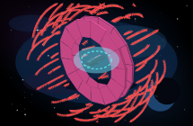
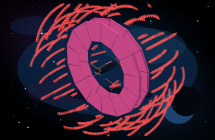
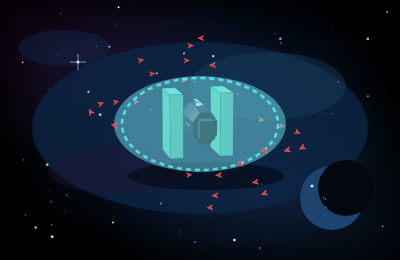
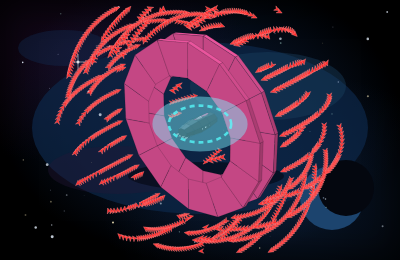
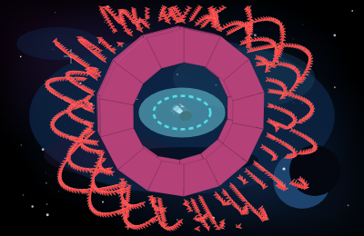
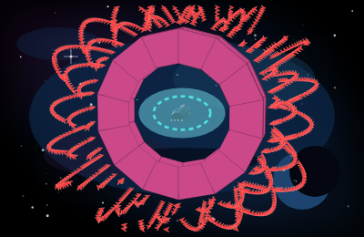
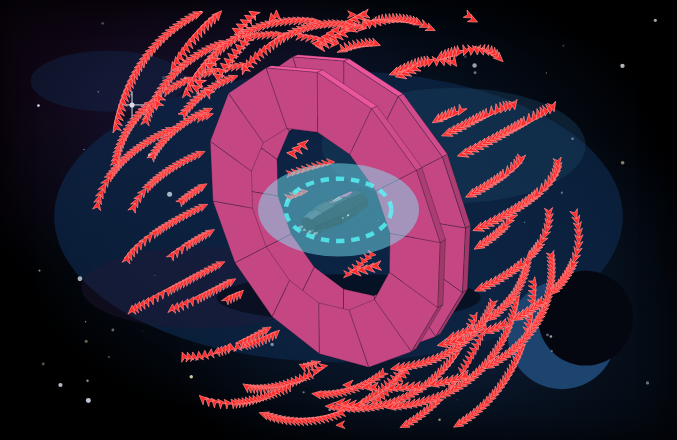
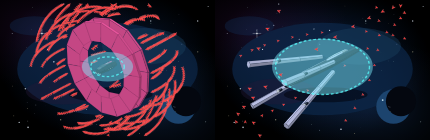
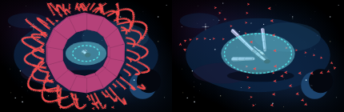

# P1b — Tholian Sentinel and Interdictor Cruiser

Parent: [batch 5 brick and hoops](cockpit-ship-stage-p1b-batch5.md). Read-test: [batch 5 acceptance](cockpit-ship-stage-p1b-batch5-acceptance.md). Gate: [batch 5 readiness](cockpit-ship-stage-p1b-batch5-readiness.md) (#335). Stills directory: [p1b-batch5-brick](stills/p1b-batch5-brick/). The stills index is [stills/README.md](stills/README.md). Same path as the [P1 spike](cockpit-ship-stage-p1-spike.md) and the cuts already on `feature/grokbot-player`: `buildHullFaces` / `projectFace` in `web/hull-meshes.js`. No three.js. WebGL stays off. This sheet records the measured faces. It does not stamp Pass.

Tholian Sentinel (`tholian_sentinel`) and Interdictor Cruiser (`interdictor_cruiser`) leave the glass loft on this wave. Merchant Cruiser, Imperial StarShip, Scout Marauder, Merchant Freighter, BattleShip, Corporate FlagShip, Escape Pod, T'Khasi Orion, CargoTran, Colonial Transport, Taurean Mule, Missile Frigate, Havoc GunStar, Star Master, and Constellation stay on the faces they already had. The Colonial is re-shot beside the Sentinel. The Constellation is re-shot beside the Interdictor. Those two meshes are not recut. The module look string stays `fleet-glass-v1`.

Panel names stay `Tholian Sentinel` and `Interdictor Cruiser`. Section token stays `box` on both. Kit is `armor` on the Sentinel and `hoop` on the Interdictor. The hoops are kit, not a section. `detail` stays `"bridge"` on the Sentinel and `"ring bridge"` on the Interdictor. Those tokens do not change the face list. A holo scanner, `photon_missiles` 10, and an engine-count swap hash the same points. Marker counts use `max(1, ceil(n / 100))` when `n ≥ 1`. The Sentinel cap of 2,500 is 25 markers. The Interdictor cap of 100,000 is 1,000 markers. A partial last hundred has no numeral. The legend stays `each marker = 100 fighters`.

## Faces and size

| Hull | Faces | Accent faces | Bounding radius | Span (x × y × z) |
| --- | --- | --- | --- | --- |
| Tholian Sentinel | 169 | 23 | 31.5 | 47.0 × 30.6 × 30.6 |
| Interdictor Cruiser | 341 | 123 | 113.9 | 57.2 × 224.0 × 218.4 |

`web/hull-meshes.js` is 64,749 bytes raw. Gzip level 9 is **16,343 bytes** from Node `zlib.gzipSync` (the call in `tests/test_cockpit_ship_stage_p1.py`) and **16,284 bytes** from Python `gzip.compress` (the call in `tests/test_cockpit_ship_stage_p1b_batch5_brick.py`). Budget is 40 KB gzipped.

The Sentinel is the fortress. Length 47.0 is shorter than the Colonial (89.7), the Escape Pod (70.8), and the Merchant Freighter (97.9). Height and beam are the same 30.6, so the head-on world box is square. Head-on at fit `1` the vertices land in (162.2, 86.1)–(233.4, 158.7), 71.1 × 72.6 px. Two armor slabs sit on the flanks. A stub box is the nose. Two bells sit at `y = -6.6`, `z = ±3.2`, inside the slab line (outer `y` and `z` ±15.3). Point hash `7650706109f94fb1`. Accent faces are not emissive.

The Interdictor is the barge. Length 57.2 stays inside both hoops. The hoops set the span: 224.0 × 218.4 against a body cylinder of 11.6 on the non-accent, non-emissive faces. Each hoop is a 14-gon, inner radius 68, outer radius 112, thickness 2.6, centered at `x = 8` and `x = -18`. The hole is empty. Bounding radius 113.9 is past the old glass floor of ~108. A 14-gon reaches 112 on `y` and 109.2 on `z`. Four bells sit on one row at `y = -3.8`, `z = ±2.3` and `±6.9`, inside the inner radius and not on an X. Point hash `c3d45f327a3c6564`. Accent faces are not emissive.

Colonial stays 251 faces, hash `7f83c52861a478ef`, span 89.7 × 53.8 × 42.0, radius 54.3. Constellation stays 311 faces, hash `787b41d482d6501a`, span 100.7 × 40.9 × 42.3, radius 64.0. The earlier pins for Merchant 217, Imperial 311, Scout 201, Freighter 251, BattleShip 226, FlagShip 210, Escape Pod 98, Orion 167, CargoTran 212, Mule 209, Missile Frigate 283, Havoc 261, and Star Master 183 did not move. This table does not replace those sheets.

Panel fit for every other hull stays the inherited rule: phone static `0.72`, 80 or more markers `0.76`, Imperial `0.84`, otherwise `1.12`. The Interdictor is the exception in `shipFit`. Radius 113.9 at fit `0.76` lands in the box (60.6, -52.9)–(358.2, 299.7). That height is 352.7 px against a 260 px frame, so the ring and the 1,000-marker cloud clip. Fit `0.72` and fit `1.12` clip the same way. Fit `0.4` keeps the ring inside the frame: three-quarter (124.2, 32.4)–(278.0, 217.0), head-on (106.3, 28.5)–(290.4, 216.6), side (107.0, 29.3)–(292.7, 219.2). `shipFit` returns `0.4` for `interdictor_cruiser` on every motion, including the phone. The Sentinel stills use `1.12`, phone `0.72`, head-on `1`, side `1.15`. At yaw `0.82` pitch `0.5` and fit `1.12` the Sentinel vertices land in (143.3, 78.0)–(233.8, 182.2).

## Stills

Canonical pose is yaw `0.82`, pitch `0.5`. Head-on is yaw `-1.35`, pitch `0.2`. Side is yaw `1.35`, pitch `0.18`. Shields full draw the bubble. Shields empty drop the bubble, draw the scar strokes, and run damage `1` through `projectFace`. Accent faces skip that wash. No name plate is drawn.

`#shipSvg` shows this viewBox at `max-height: 140px`. The 140px singles are 215×140. The canonical singles are 400×260. The hero singles are 677×440. Pair frames are two cells side by side: 430×140 and 1354×440. Phone, `prefers-reduced-motion`, and `body.cu-seat` hold the canonical three-quarter pose and do not loop. The Sentinel phone still is 400×260 at fit `0.72`. The Interdictor phone still is the same 400×260 frame at fit `0.4`, because `0.72` crops the ring. This wave does not edit `web/redesign.css`.

Marker counts on these frames: Sentinel 25, Interdictor 1,000, Colonial 2, Constellation 50. Neither new hull is on `SHIP_TW_CHART_RANGE`. Pass pose is idle cyan-white cones. A fitted drive recolours the cones only, and this wave does not reserve a TransWarp still.

Tholian Sentinel, shields full, 25 markers, 140px. Short blunt brick, mint slabs on both flanks:

Tholian Sentinel, shields empty, 140px. The slabs and the stripe stay `#62f0c8`. Scars draw. The bubble is gone:

Interdictor Cruiser, shields full, 1,000 markers outside the hoops, 140px. The hoops are the first shape:

Interdictor Cruiser, shields empty, 140px. The rims and the stripe stay `#ff5cab`. The hole stays empty:

Sentinel three-quarter, head-on, and side. Head-on is nearly square. The slabs are the sides. The nose is a stub. Two mouths sit low, inside the square:

Interdictor three-quarter, head-on, and side. Head-on is a ring with a body in the hole. The side camera shows two hoops larger than the body, and four mouths on a low row inside them:

Hero crops, shields full. The brick stays short. The hoops stay the first shape, with the hole empty:

A brick beside the Colonial hauler, 140px. The Sentinel is the square. The Colonial keeps the cabin row and the belly tanks:

A hoop beside the Constellation X, 140px. Head-on is a ring with a body in the hole, next to an X of four nacelles:

Every file under `docs/plans/stills/p1b-batch5-brick/` is shot. Singles are 215×140, 400×260, or 677×440. Pairs are 430×140 or 1354×440.

| File | Pixels | Shot |
| --- | --- | --- |
| `ts-3q-full-140.png`, `ts-3q-empty-140.png` | 215×140 | Shields full, shields 0, 25 markers, fit `1.12` |
| `ts-3q-full.png`, `ts-3q-empty.png`, `ts-head.png`, `ts-head-empty.png`, `ts-side.png` | 400×260 | Three-quarter fit `1.12`, head-on fit `1`, side fit `1.15` |
| `ts-phone.png` | 400×260 | Phone fit `0.72`, 25 markers |
| `ts-3q-full-hero.png`, `ts-3q-empty-hero.png` | 677×440 | Hero, shields full and shields 0 |
| `ic-3q-full-140.png`, `ic-3q-empty-140.png` | 215×140 | Shields full, shields 0, 1,000 markers, fit `0.4` |
| `ic-3q-full.png`, `ic-3q-empty.png`, `ic-head.png`, `ic-head-empty.png`, `ic-side.png`, `ic-phone.png` | 400×260 | Three-quarter, head-on, side, and phone, all at fit `0.4` |
| `ic-3q-full-hero.png`, `ic-3q-empty-hero.png` | 677×440 | Hero, shields full and shields 0, fit `0.4` |
| `pair-ts-col-*` | 430×140, hero 1354×440 | Brick beside the hauler, 25 markers and 2 markers |
| `pair-ic-con-*` | 430×140, hero 1354×440 | Hoops beside the X, 1,000 markers and 50 markers |

## Brick and hoops tells

Cover the name plate. These reads hold on the stills above, at 140px and at the hero crop, shields 0 and shields full.

| Tell | Where it reads |
| --- | --- |
| Short blunt brick. Armor slabs on both flanks. Head-on nearly square, 71.1 × 72.6 px. Stub nose | `ts-3q-full.png`, `ts-head.png`, `ts-side.png`, hero and 140px |
| Two engines sit low, inside the square and inside the slab line | `ts-head.png`, `ts-side.png`. Mouths at `y = -6.6`, `z = ±3.2`, slab outer ±15.3 |
| Slab faces and stripe stay `#62f0c8` at shields 0. The fuselage stays dark metal | `ts-3q-empty.png`, `ts-head-empty.png`. Accent average `[81, 198, 165]` at damage 0 and 1 |
| Markers sit outside the slabs. None sit in the brick | Cap 25. Placed 25, under / overlap / clipped 0 |
| Two hoops larger than the body, first shape from the side and head-on. Head-on is a ring with a body in the hole. The hole is empty | `ic-3q-full.png`, `ic-head.png`, `ic-side.png`, hero and 140px. Outer radius 112, radius 113.9 |
| Four mouths sit on one low row on the body, inside the hoops. They are not an X | `ic-side.png`. Mouths at `y = -3.8`, `z = ±2.3` and `±6.9`, inside inner radius 68 |
| Both rims and the stripe stay `#ff5cab` at shields 0. The body stays dark metal. The hole stays empty | `ic-3q-empty.png`, `ic-head-empty.png`. Accent average `[198, 71, 133]` |
| Markers sit outside the hoops. None sit in the hole. None sit on the skin | Cap 1,000. Placed 1,000, under / overlap / clipped / hole 0. Minimum cylinder past the outer rim |
| A square brick versus a tall hauler with belly tanks | `pair-ts-col-3q-140.png`, `pair-ts-col-head-140.png`, `pair-ts-col-side-140.png` |
| A ring versus an X of four nacelles | `pair-ic-con-3q-140.png`, `pair-ic-con-head-140.png`, `pair-ic-con-side-140.png` |

A full mint body, a full pink body, a full red body, a filled disc, canards, a wedge nose, and an X of nacelles on the Interdictor are not what these stills show.

## Colonial and Constellation re-shots

Reads of meshes that have already landed. This wave does not recut them. Colonial Transport beside the Sentinel keeps `#7dff7d` on the stripe and the tank rims, including at shields 0. The cap is 2 markers. Accent average `[102, 208, 102]` at damage 0 and 1. Body at damage 1 is `[39, 51, 64]`. Face count stays 251.

Constellation beside the Interdictor keeps `#d0d6ff` on the nacelles and the stripe, including at shields 0. The cap is 50 markers. Accent average `[168, 173, 206]` at damage 0 and 1. Body at damage 1 is `[41, 51, 65]`. Face count stays 311. Head-on stays an X. The Interdictor cell in the pair still shows 1,000 darts outside the hoops.

| File | Pixels | Shot |
| --- | --- | --- |
| `pair-ts-col-3q-140.png`, `pair-ts-col-3q-empty-140.png`, `pair-ts-col-head-140.png`, `pair-ts-col-side-140.png` | 430×140 | Shields full and shields 0, three-quarter, head-on, side |
| `pair-ts-col-3q-hero.png` | 1354×440 | Hero, shields full |
| `pair-ic-con-3q-140.png`, `pair-ic-con-3q-empty-140.png`, `pair-ic-con-head-140.png`, `pair-ic-con-side-140.png` | 430×140 | Shields full and shields 0, three-quarter, head-on, side |
| `pair-ic-con-3q-hero.png` | 1354×440 | Hero, shields full |

## Markers

`escortSlots` places shells outside the bounding sphere, kit included. Screen boxes do not hit the silhouette and do not clip the 400×260 frame. On the Interdictor, a marker whose `hypot(y, z)` falls inside the hoop cylinder (outer 112, plus a margin of 3) is skipped and the next sample on that shell takes the slot. Counts of 800 or more on that hoop use a tighter shell (`sep` 2.0 / 1.6 / 0, ring step 2.4) so 1,000 darts stay near the rim and inside the frame at fit `0.4`. Other hulls keep the shells they already had. The count stays `max(1, ceil(n / 100))`. There is no silent cap.

| Case | Markers | Placed | Under / overlap / clipped |
| --- | --- | --- | --- |
| Sentinel, bay 0 | 0 | 0 | 0 / 0 / 0 |
| Sentinel, bay 1–100 (bay 50 and bay 100) | 1 | 1 | 0 / 0 / 0 |
| Sentinel, bay 101–200 | 2 | 2 | 0 / 0 / 0 |
| Sentinel, bay 2,400 | 24 | 24 | 0 / 0 / 0 |
| Sentinel, bay 2,401–2,500 | 25 | 25 | 0 / 0 / 0 |
| Interdictor, bay 0 | 0 | 0 | 0 / 0 / 0 |
| Interdictor, bay 1–100 | 1 | 1 | 0 / 0 / 0 |
| Interdictor, bay 101–200 | 2 | 2 | 0 / 0 / 0 |
| Interdictor, bay 50,000 | 500 | 500 | 0 / 0 / 0, hole 0 |
| Interdictor, bay 99,900 | 999 | 999 | 0 / 0 / 0, hole 0 |
| Interdictor, bay 99,901–100,000 | 1,000 | 1,000 | 0 / 0 / 0, hole 0 |
| Colonial re-shot, bay 200 | 2 | 2 | prior pin, mesh not recut |
| Constellation re-shot, bay 5,000 | 50 | 50 | prior pin, mesh not recut |

Sentinel clearance is fit `1.12`, phone `0.72`, head-on fit `1`, and side fit `1.15`, for counts 0, 1, 2, 24, and 25. Interdictor clearance is fit `0.4` on those four cameras, for counts 0, 1, 2, 500, 999, and 1,000. No numeral is drawn on a dart.

## Frame time

Node 22.23.4 on this VM. One `drawShipFrame`-shaped update: project every face, build the point string, and project each marker. Nine samples after four warmups. Median / max. Slot bake is one sample, the cost when the bay changes, not part of the frame. The bar is the JS frame, 16 ms.

| Frame | Fit | Markers | Bake | JS frame |
| --- | --- | --- | --- | --- |
| Tholian Sentinel, canonical | 1.12 | 25 | 2.15 ms | 0.22 / 0.46 ms |
| Interdictor Cruiser, shipped pose | 0.4 | 1,000 | 8.56 ms | 0.69 / 1.34 ms |
| Interdictor Cruiser, fit `0.76` (clips; not a still) | 0.76 | 1,000 | 17.08 ms | 0.55 / 0.74 ms |
| Interdictor Cruiser, fit `1.12` (clips; not a still) | 1.12 | 1,000 | 9.45 ms | 0.55 / 0.94 ms |
| Imperial, drift-shaped | 0.76 | 500 | 1.71 ms | 0.45 / 0.65 ms |
| Imperial, static-shaped | 0.72 | 1,000 | 2.68 ms | 0.52 / 0.64 ms |

The shipped Interdictor frame is the drift measurement for this wave: 1,000 markers at fit `0.4`, 0.69 / 1.34 ms. Fit `0.76` and fit `1.12` also project under 16 ms, and both leave the ring outside the 400×260 frame, so they are not the still and not the panel fit. The bake at fit `0.76` is the wider shell walking off the frame before the count fills. It is not the frame update. All six JS frames sit under 16 ms, so the markers stay individual SVG paths. The count stays `ceil(n / 100)`. The Imperial rows are the inherited P1 bar on the file this wave ships. The Imperial mesh is not recut.

## Shields 0

Accent fill, averaged over the same five cameras at damage 0 and damage 1, did not move. A fitted TransWarp drive did not move it either. Idle cones are cyan-white. A fitted drive turns the cones magenta and leaves the accent where it was. Neither new hull is on `SHIP_TW_CHART_RANGE`. The pass pose is the idle cones.

| Hull | Accent at damage 0 and 1 | Body at damage 1 | Idle plume | Fitted TransWarp plume |
| --- | --- | --- | --- | --- |
| Tholian Sentinel | `[81, 198, 165]` on the slab faces and the stripe | `[42, 54, 66]` | `[246, 255, 255]` | `[255, 211, 255]` |
| Interdictor Cruiser | `[198, 71, 133]` on both rims and the stripe | `[42, 49, 63]` | `[247, 255, 255]` | `[255, 212, 255]` |
| Colonial Transport (re-shot) | `[102, 208, 102]` `#7dff7d` | `[39, 51, 64]` | `[248, 255, 246]` | `[255, 220, 246]` |
| Constellation (re-shot) | `[168, 173, 206]` `#d0d6ff` | `[41, 51, 65]` | `[247, 255, 255]` | `[255, 212, 255]` |

The fitted drive recolours the cones. The slabs, the rims, and the stripes stay flat metal (`accent` set, `emissive` clear). Scars draw. The bubble is absent at zero shields. The body stays dark blue-grey. A full body painted `#62f0c8` or `#ff5cab` is not what these averages show. The Interdictor hole stays open at shields 0.

## Checklist notes

Recorded against the batch-5 contract. This sheet does not stamp Pass.

- Both hulls are on `buildHullFaces` / `projectFace`. `sentinelSpike` and `interdictorSpike` return before the glass loft. No `three` import and no WebGL context in `web/hull-meshes.js`.
- The Sentinel reads as a short square brick with mint slabs, a stub nose, and two low engines inside the slabs. The Interdictor reads as two pink hoops larger than the body, a body in an empty hole, and four mouths on a low row.
- Colonial stays 251 faces. Constellation stays 311 faces. The other prior face counts listed above stay on their pins. The re-shots are the pair stills.
- Shields empty keeps `#62f0c8` on the slabs and `#ff5cab` on the rims.
- Marker formula, the 25-marker cap, the 1,000-marker cap, and the empty hoop hole are pinned in `tests/test_cockpit_ship_stage_p1b_batch5_brick.py`. `fleet-glass-v1` rows for these two hulls moved out of `FLEET_GLASS`. Pins for hulls this wave does not cut stay.
- Gzip 16,343 bytes (Node) and 16,284 bytes (Python), both under 40 KB. The shipped frame rows above sit under 16 ms.
- Phone, reduced motion, and `body.cu-seat` are the canonical three-quarter still. The Interdictor still draws 1,000 darts at fit `0.4`. No separate loop.
- `shipFit` returns `0.4` for the Interdictor so the live panel matches the still. Other hulls keep `0.72` / `0.76` / `0.84` / `1.12`. No engine change, no new action, no new event field.
