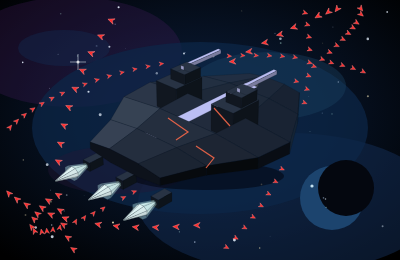
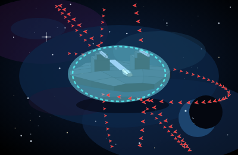
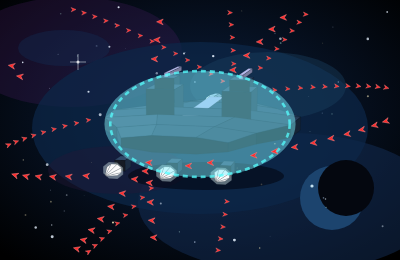
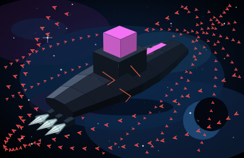
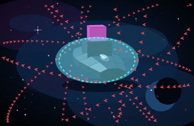
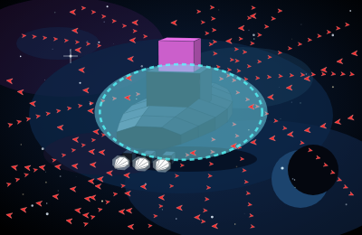
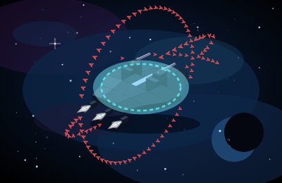

# P1b — BattleShip and Corporate FlagShip

Parent: [next hulls](cockpit-ship-stage-p1b-next-hulls.md). Same path as the [P1 spike](cockpit-ship-stage-p1-spike.md) and the [Scout and Freighter cut](cockpit-ship-stage-p1b-scout-freighter.md): `buildHullFaces` / `projectFace` in `web/hull-meshes.js`. No three.js. WebGL stays off.

The stills inventory is [stills/README.md](stills/README.md) (#344), directory [p1b-battleship-flagship](stills/p1b-battleship-flagship/).

BattleShip (`battleship`) and Corporate FlagShip (`corporate_flagship`) leave `fleet-glass-v1` on this cut. Scout Marauder, Merchant Freighter, Merchant Cruiser, and Imperial StarShip stay on the faces they already had. The other hulls stay on `fleet-glass-v1`.

Accents and engine counts are the panel `SHIPS` row. Marker counts use `max(1, ceil(n / 100))` when `n ≥ 1`. BattleShip cap 10,000 is 100 markers on both rosters. FlagShip cap 20,000 is 200. A partial last hundred has no numeral. The legend stays `each marker = 100 fighters`.

## Faces and size

| Hull | Faces | Accent faces | Bounding radius | Span (x × y × z) |
| --- | --- | --- | --- | --- |
| BattleShip | 226 | 13 | 67.0 | 113.3 × 31.4 × 81.3 |
| Corporate FlagShip | 210 | 7 | 78.0 | 139.2 × 44.2 × 44.3 |
| Scout Marauder (unchanged) | 201 | 23 | 92.0 | 178.6 × 20.0 × 64.0 |
| Merchant Freighter (unchanged) | 251 | 35 | 60.6 | 97.9 × 16.0 × 97.8 |
| Merchant Cruiser (unchanged) | 217 | 41 | 79.0 | 142.6 × 37.0 × 61.5 |
| Imperial StarShip (unchanged) | 311 | 71 | 116.9 | 216.5 × 57.3 × 51.1 |

`web/hull-meshes.js` is 39,293 bytes raw and **10,426 bytes gzipped** (level 9). Budget is 40 KB gzipped.

The BattleShip is a wide hex wedge, shorter than the Imperial and broader than the Merchant. Its length (113.3) is short for that beam (81.3). Two turret bodies sit on the dorsal face. Their barrels are the high points (`y = 20.2`, off the centerline). Three bells sit in a low row at the tail, inside the hex width. The FlagShip is a longer liner with an ordinary beam. Its tower is a lower metal step and a smaller upper step amidships. From the hull skin up to the upper step is 24.0, and the hull depth under that skin is 16.8. The upper step tops out at `y = 33.6`. Three bells sit in a low row under the stern, inside the beam. The Imperial remains the long castle with four bells in a square.

Panel fit is unchanged: phone static `0.72`, 80 or more markers `0.76`, Imperial `0.84`, other hulls `1.12`. A full BattleShip or FlagShip bay is 80 or more markers, so the panel also uses `0.76`. At yaw `0.82` pitch `0.5` and fit `1.12`, every vertex of both hulls lands inside the 400×260 view.

## Stills

Canonical pose is yaw `0.82`, pitch `0.5`. Head-on is clip camera `headon` (`yaw -1.35`, `pitch 0.2`). Side is clip camera `side` (`yaw 1.35`, `pitch 0.18`). Shields full draw the bubble. Shields empty drop the bubble, draw the scar strokes, and run damage `1` through `projectFace`. Accent faces skip that wash.

`#shipSvg` shows this viewBox at `max-height: 140px`. The 140px stills are that frame. The hero stills are the same viewBox at 440px tall, about 55% of an 800px deck. Phone, `prefers-reduced-motion`, and `body.cu-seat` hold this pose and do not loop. The phone still uses fit `0.72`. The three-quarter stills use fit `1.12`, where the 100-marker and 200-marker rings still clear the frame.

BattleShip, shields full, 100 markers, 140px:

Corporate FlagShip, shields full, 200 markers, 140px:

BattleShip three-quarter, shields full and empty. Empty keeps the `#c5c8ff` barrels and stripe, draws scars, and drops the bubble:

BattleShip head-on and side. Head-on the hex shoulders are the left and right extremes and the barrel tips are the high points. The side camera shows the three mouths in a low row inside the hex width:

FlagShip three-quarter, shields full and empty. The upper step and the stripe stay `#ff77ff`:

FlagShip with a fitted TransWarp drive. The cones go magenta. The upper step stays flat `#ff77ff`:

FlagShip head-on, idle cones and fitted cones. The rectangle on the centerline is the tower. Fitted cones recolour in the three-quarter still; the upper step stays the same pink in both head-on frames:

FlagShip side. Three mouths in a low row, inside the beam, with the tower still the high point:

Hero crop, shields full:

Phone fit `0.72`, same pose, full bays:

Head-on, the BattleShip silhouette is 172 by 71. The FlagShip silhouette is 110 by 113, with the tower as the top of the frame.

## Markers

`escortSlots` at the canonical pose, the panel fit for a full bay, the phone fit, head-on, and the side clip. Every placed slot is outside the bounding sphere, kit included. Screen boxes do not hit the silhouette and do not clip the 400×260 frame.

| Case | Markers | Placed | Under / overlap / clipped |
| --- | --- | --- | --- |
| Either hull, bay 0 | 0 | 0 | 0 / 0 / 0 |
| Either hull, bay 1–100 | 1 | 1 | 0 / 0 / 0 |
| BattleShip, bay 10,000 | 100 | 100 | 0 / 0 / 0 |
| FlagShip, bay 20,000 | 200 | 200 | 0 / 0 / 0 |

Checked at fit `1.12` and `0.76` (yaw `0.82`, pitch `0.5`), phone fit `0.72`, head-on fit `1`, and side fit `1.15`. The barrels set the top of the BattleShip sphere. The upper step sets the top of the FlagShip sphere.

## Frame time

Node 22 on this VM. One `drawShipFrame`-shaped update: project every face, build the point string, project each marker. Nine samples after four warmups. Median / max. Slot bake is the cost when the bay changes, not part of the frame.

| Frame | Fit | Markers | Bake | JS frame |
| --- | --- | --- | --- | --- |
| BattleShip, canonical | 1.12 | 100 | 5.2 ms | 0.55 / 1.32 ms |
| BattleShip, panel fit | 0.76 | 100 | 1.8 ms | 0.33 / 0.41 ms |
| FlagShip, canonical | 1.12 | 200 | 2.8 ms | 0.34 / 0.49 ms |
| FlagShip, panel fit | 0.76 | 200 | 1.7 ms | 0.31 / 0.61 ms |
| Imperial, drift-shaped | 0.76 | 500 | 5.3 ms | 0.47 / 0.89 ms |
| Imperial, static-shaped | 0.72 | 1,000 | 4.7 ms | 0.62 / 0.72 ms |

All six sit under the 16 ms bar, so the markers stay individual SVG paths. This bench is the projection work in Node. It does not include a browser layout.

## Shields 0

Accent fill, averaged over the same five cameras at damage 0 and damage 1, did not move. A fitted TransWarp drive did not move it either.

| Hull | Accent at damage 1 | Body at damage 1 | Idle plume | Fitted TransWarp plume |
| --- | --- | --- | --- | --- |
| BattleShip | `[160, 162, 207]` lavender `#c5c8ff` | `[38, 48, 62]` | `[246, 255, 255]` | `[255, 211, 255]` |
| Corporate FlagShip | `[211, 98, 211]` pink `#ff77ff` | `[42, 51, 66]` | `[246, 255, 255]` | `[255, 211, 255]` |

The fitted drive recolours the FlagShip cones. The upper step and the stripe stay the class accent, and those faces are flat metal (`accent` set, `emissive` clear). Scars draw. The bubble is absent at zero shields.
