# P1b — Scout Marauder and Merchant Freighter

Parent: [next hulls](cockpit-ship-stage-p1b-next-hulls.md). Same path as the [P1 spike](cockpit-ship-stage-p1-spike.md): `buildHullFaces` / `projectFace` in `web/hull-meshes.js`. No three.js. WebGL stays off.

This cut is the first two hulls of the four-hull wave. BattleShip and Corporate FlagShip stay on `fleet-glass-v1`, with the rest of the fleet.

Accents and engine counts are the panel `SHIPS` row. Marker counts use `max(1, ceil(n / 100))` when `n ≥ 1`. Scout base cap 150 is 2 markers; the live cap 250 is 3. Freighter cap 300 is 3 on both rosters. A partial last hundred has no numeral. The legend stays `each marker = 100 fighters`.

## Faces and size

| Hull | Faces | Accent faces | Bounding radius | Span (x × y × z) |
| --- | --- | --- | --- | --- |
| Scout Marauder | 201 | 23 | 92.0 | 178.6 × 20.0 × 64.0 |
| Merchant Freighter | 251 | 35 | 60.6 | 97.9 × 16.0 × 97.8 |
| Merchant Cruiser (unchanged) | 217 | 41 | 79.0 | 142.6 × 37.0 × 61.5 |
| Imperial StarShip (unchanged) | 311 | 71 | 116.9 | 216.5 × 57.3 × 51.1 |

`web/hull-meshes.js` is 37,085 bytes raw and **9,933 bytes gzipped** (level 9). Budget is 40 KB gzipped.

The Imperial is still the longest hull. The Scout is longer than the Merchant and thinner: canard tips at `|z| = 32`, tail fins inside `|z| = 8.4`, body a round tube. The Freighter's width matches its length. Its lowest point is `y = -7.2`. The Merchant keel still reaches `y = -24.5`. Cheek rims are the outer silhouette. Both engine bells sit inboard of those rims. Warm port lamps sit on the outer cheek.

Panel fit is unchanged: phone static `0.72`, 80 or more markers `0.76`, Imperial `0.84`, these two hulls `1.12`. At yaw `0.82` pitch `0.5` and fit `1.12`, every vertex of both hulls lands inside the 400×260 view.

## Stills

Canonical pose is yaw `0.82`, pitch `0.5`. Head-on is clip camera `headon` (`yaw -1.35`, `pitch 0.2`). Side is clip camera `side` (`yaw 1.35`, `pitch 0.18`). Shields full draw the bubble. Shields empty drop the bubble, draw the scar strokes, and run damage `1` through `projectFace`. Accent faces skip that wash.

`#shipSvg` shows this viewBox at `max-height: 140px`. The 140px stills are that frame. The hero stills are the same viewBox at 440px tall, about 55% of an 800px deck. Phone, `prefers-reduced-motion`, and `body.cu-seat` hold this pose and do not loop. The phone still uses fit `0.72`.

Scout, shields full, 3 markers (live cap), 140px:

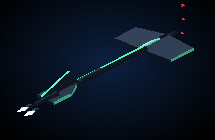

Freighter, shields full, 3 markers, 140px:

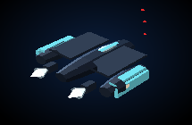

Scout three-quarter, shields full and empty (empty is the base cap, 2 markers):

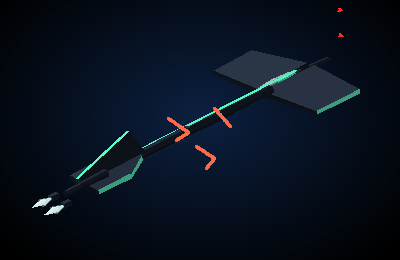

Scout head-on and side:

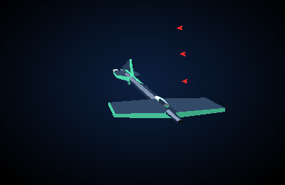

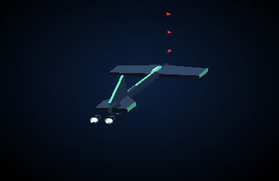

Freighter three-quarter, shields full and empty:

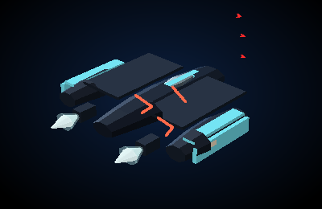

Freighter head-on and side:

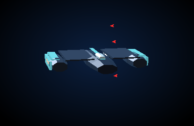

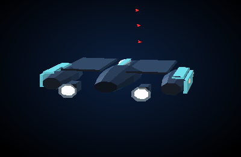

Hero crop, shields full:

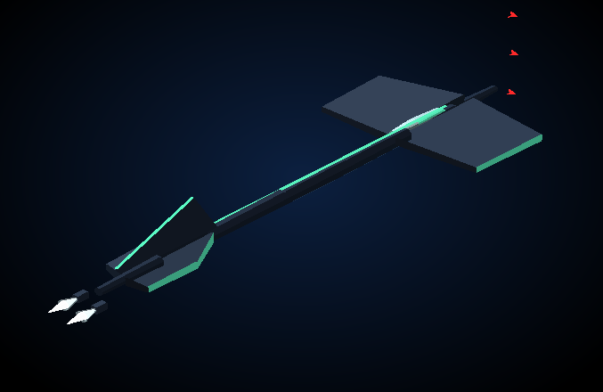

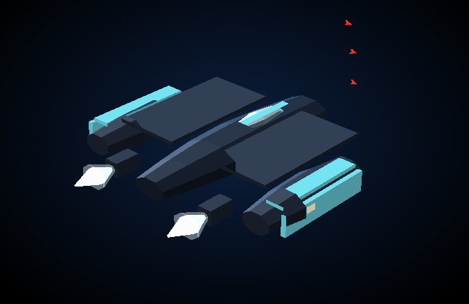

Phone fit, same pose, 3 markers:

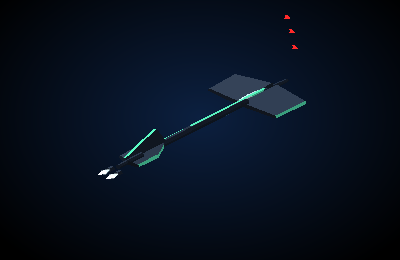

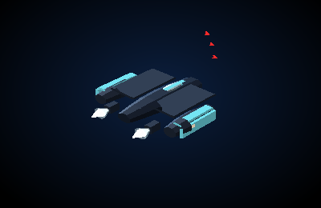

Head-on, the Scout's left and right extremes are the canard tips (`|z| > 24`, `|y| < 4`). The top extreme is the tail fin (`y > 10` on the centerline). The Freighter's left and right extremes are the cheek rims (`|z| > 40`), and the head-on silhouette is more than three times as wide as it is tall.

## Markers

`escortSlots` at the canonical pose, the phone fit, head-on, and the side clip. Every placed slot is outside the bounding sphere. Screen boxes do not hit the silhouette and do not clip the 400×260 frame.

| Case | Markers | Placed | Under / overlap / clipped |
| --- | --- | --- | --- |
| Either hull, bay 0 | 0 | 0 | 0 / 0 / 0 |
| Scout or Freighter, bay 1–100 | 1 | 1 | 0 / 0 / 0 |
| Scout, bay 150 (base cap) | 2 | 2 | 0 / 0 / 0 |
| Scout, bay 250 (live cap) | 3 | 3 | 0 / 0 / 0 |
| Freighter, bay 300 | 3 | 3 | 0 / 0 / 0 |

Checked at fit `1.12` and `0.72` (yaw `0.82`, pitch `0.5`), head-on fit `1`, and side fit `1.15`.

## Frame time

Node 22 on this VM. One `drawShipFrame`-shaped update: project every face, build the point string, project each marker. Nine samples after four warmups. Median / max. Slot bake is the cost when the bay changes, not part of the frame.

| Frame | Fit | Markers | Bake | JS frame |
| --- | --- | --- | --- | --- |
| Scout, canonical spin | 1.12 | 3 | 3.2 ms | 0.45 / 0.58 ms |
| Freighter, canonical spin | 1.12 | 3 | 2.7 ms | 0.33 / 0.48 ms |
| Imperial, drift-shaped | 0.76 | 500 | 7.2 ms | 0.67 / 0.76 ms |
| Imperial, static-shaped | 0.72 | 1,000 | 6.2 ms | 0.50 / 0.68 ms |

All four sit under the 16 ms bar, so the markers stay individual SVG paths. This bench is the projection work in Node. It does not include a browser layout.

## Shields 0

Accent fill, averaged over the same five cameras at damage 0 and damage 1, did not move.

| Hull | Accent at damage 1 | Body at damage 1 | Idle plume | Fitted TransWarp plume |
| --- | --- | --- | --- | --- |
| Scout Marauder | `[74, 203, 159]` mint `#5dffc8` | `[39, 52, 65]` | `[246, 255, 255]` | `[255, 211, 255]` |
| Merchant Freighter | `[99, 195, 207]` cyan `#7af0ff` | `[43, 55, 70]` | `[242, 248, 246]` | `[250, 208, 246]` |

The fitted drive recolours the cones. The canard edges, cheek rims, and stripe stay the class accent. Scars draw. The bubble is absent at zero shields.
