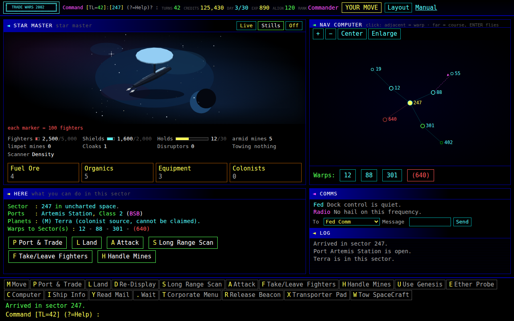
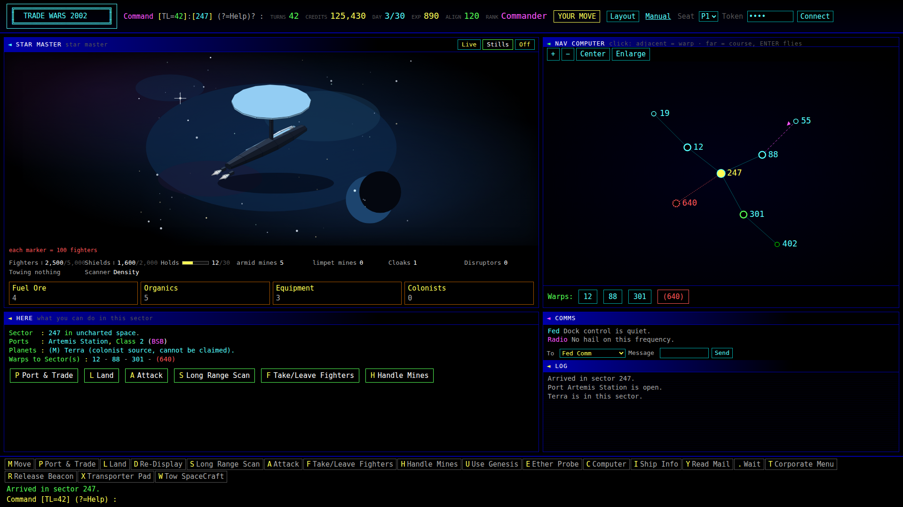
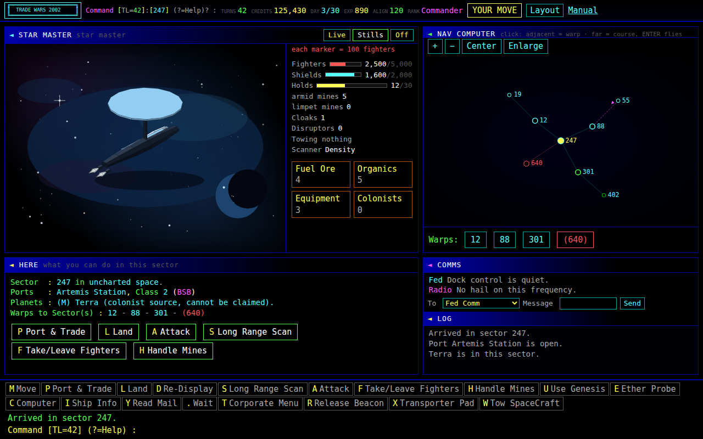
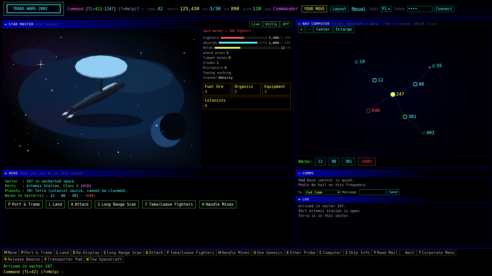
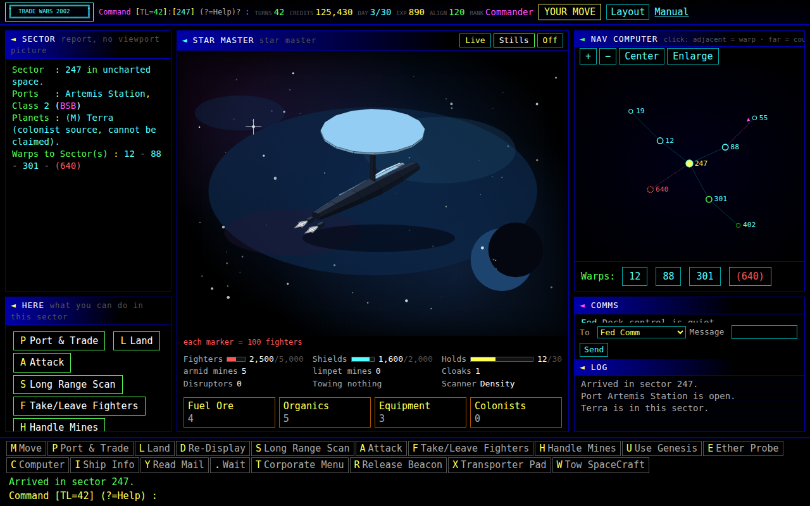
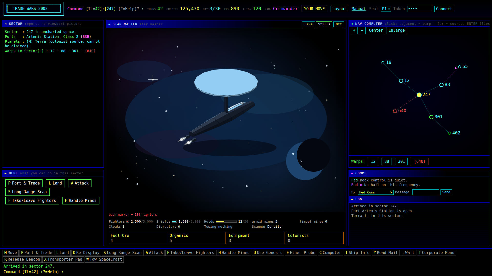

# P3 layout mock — ship stage beside the map

Research only. This note does not stamp Pass. It does not open the P3 product PR, the P2 wire, or the batch-5 gate. It does not edit the [P3 layout checklist](cockpit-ship-stage-p3-layout.md), the [P3 readiness note](cockpit-ship-stage-p3-readiness.md), the fleet order, the stills inventory, the cockpit source, or the hull meshes. WebGL stays off. The sticky order stays the batch-5 Pass, then P2, then P3.

The mock is a standalone page: [samples/p3-layout/index.html](../../samples/p3-layout/index.html). Open that file in a browser. The gallery shows six frames. `?variant=a&capture=1` (also `b` and `c`) fills the window with one variant. Nothing on the page calls the game. There is no canvas and no WebGL. The page does not load `web/redesign.js` or `web/hull-meshes.js`.

Tip this mock was checked against: `feature/grokbot-player` @ `0bf683e3` (#402). That commit lands the batch-5 brick meshes and its product sheet does not stamp Pass. Star Master stays 183 faces on that tip. This mock uses that hull.

## What the page is

One static cockpit, three grids. The picture is a copy of `TW2KHullMeshes.markup` for `star_master` at the canonical still: yaw `0.82`, pitch `0.5`, fit `1.12`, origin `(200, 124)`. The mesh is 183 faces. The still draws the 85 front faces. Those 85 polygons match `markup()` on `web/hull-meshes.js` at `0bf683e3`. `viewBox` stays `0 0 400 260`. `preserveAspectRatio` stays `xMidYMid meet`. The element has no `max-height`.

The panels are the current cockpit set, with the left viewport picture removed. `#ship` holds the stage, an empty `#stageFx` slot, the fighter legend, the stat block, and the holds. `#nav` holds the sector map, the zoom row, and the warp buttons. `#context` is HERE. `#term` is COMMS and LOG. Variants A and B put the sector report in HERE, under the heading and above the verbs. Variant C puts that report in a left rail. Live / Stills / Off sit in the ship heading so they do not take a row under the picture. Stills is the pressed state. Fighter markers are not drawn. The legend line is `each marker = 100 fighters`. The seat and token cluster is hidden below 1600px so the 1280 header stays one line. The 1920 frames show it.

Buttons are inert. The map is a static sector sketch in the same vocabulary as `#map` (here, adjacent, port, unknown, one-way), not a live `map()` render.

## How the frames were measured

Headless Chrome, device metrics 1280×800 and 1920×1080, `deviceScaleFactor` 1. Fractions are border-box width divided by the deck content box: `#deck.clientWidth` minus the 8px of padding on each side. That content box is 1264px at 1280 and 1904px at 1920. Tops of `#ship` and `#nav` differ by 0. The areas string has no `view`. `#holds` lies fully inside `#ship` on every frame. Stills are in [samples/p3-layout/stills/](../../samples/p3-layout/stills/).

## A — Checklist hero

Deck tracks `minmax(0, 1.5fr)` and `minmax(0, 1fr)`. Areas `"ship nav" "here term"`. The readout stays stacked under the picture: legend, stats, holds. This is the grid in the layout checklist.

| | 1280×800 | 1920×1080 |
| --- | --- | --- |
| `#ship` | 0.596 | 0.597 |
| `#nav` | 0.397 | 0.398 |
| `#shipSvg` element | 752×229 | 1136×412 |
| Painted hull | 145×129 | 262×232 |
| Last HERE verb inside `#context` | yes | yes |

Both ship fractions sit in the 0.55–0.60 band. Both map fractions sit in the 0.35–0.42 band. The SVG element is taller than the old 164px cap at both sizes. The painted hull clears 164px only at 1920. At 1280 the stage is 752×229, wider than the 400×260 viewBox, so `meet` letterboxes the sides and the painted hull stays 129px tall.

Trade-off. The bands pass, HERE and COMMS keep a full column, and the sector report sits in HERE without covering the map. The extra width in the ship column does not become a larger hull while the stage is shorter than the viewBox. A bigger painted ship at 1280 needs a taller stage, which is variant B, or a later art pass inside the same viewBox.

## B — Readout rail

Same deck as A, so the fractions match A: ship 0.596 / 0.597, map 0.397 / 0.398. Inside `#ship`, the legend, stats, and holds move into a rail beside the picture. The stage takes the full height of the top row.

| | 1280×800 | 1920×1080 |
| --- | --- | --- |
| `#shipSvg` element | 511×380 | 772×544 |
| Painted hull | 211×187 | 318×282 |
| `#holds` inside `#ship` | yes | yes |
| Last HERE verb inside `#context` | yes | yes |

Trade-off. The painted hull grows from 145×129 to 211×187 at 1280, and from 262×232 to 318×282 at 1920, without leaving the checklist bands. The stat block leaves the stacked order under the stage. The rail is a single column of bars, so the readout is taller and narrower. The layout checklist asks for `#fighterRow`, `#shipStats`, and `#holds` as siblings after `#shipStage`. B is the research alternative if that order can move. It is not the default the checklist already wrote down.

## C — Center span

Three tracks, `0.72fr 1.7fr 1fr`. Areas `"report ship nav" "here ship term"`. The ship spans both rows. The sector report is a left rail. HERE is under that rail. The map stays on the right.

| | 1280×800 | 1920×1080 |
| --- | --- | --- |
| `#ship` | 0.491 | 0.493 |
| `#nav` | 0.289 | 0.290 |
| Left rail | 0.208 | 0.209 |
| `#shipSvg` element | 618×451 | 936×719 |
| Painted hull | 255×226 | 386×343 |
| Last HERE verb inside `#context` | no | yes |

Trade-off. This is the literal middle column. The painted hull is the largest of the three (255×226 at 1280, 386×343 at 1920) because the stage keeps the height of both rows. The ship fraction is about 0.49 and the map fraction is about 0.29, so both bands miss. Two 8px gaps plus a readable left rail are what spend the width. A third track cannot hold 0.55–0.60 and 0.35–0.42 at the same time unless the rail is a sliver. At 1280 the nav heading clips the click hint, the sector report wraps hard, and the last HERE verb's border box is not fully inside `#context`. At 1920 the hint fits and that verb is inside.

## Recommendation

Use variant A for the product grid when the gate opens. It is the checklist's `1.5fr / 1fr` deck, the ship and map bands both pass, the tops align, the areas string has no `view`, and `#holds` stays inside `#ship` at 1280×800 and at 1920×1080.

Keep variant B as the follow-up if a 1280 still of A reads small. B stays on the same bands and is the change that actually enlarges the painted hull. It needs an explicit decision to move the readout beside the stage.

Leave variant C as the rejected reading of "central." The hero is the ship column in A, not a middle track.

This recommendation does not open the product PR. P3 stays behind the batch-5 Pass and then P2.

## Open questions

- Does Ben still want the 0.55–0.60 / 0.35–0.42 bands, or is a larger painted hull at 1280 worth moving the readout beside the stage (B)?
- Is "central" the hero column in A, or a middle column? C shows the middle column cannot keep both bands.
- The 1280 stage in A is a wide letterbox. Is a painted hull of 129px acceptable until an art pass fills more of the 400×260 viewBox, given that the SVG element itself is already 229px?
- Live / Stills / Off are in the ship heading here. P2 has not landed, so the product host for those buttons is still the one the wire describes. `#stageFx` is an empty overlay in this mock and plays nothing.
- Star Master is the crop because it is Landed+Pass and the 183-face pin did not move on `0bf683e3`. A wider capital would occupy more of the same viewBox. That choice is an art pass.
- Phone width, the 48px cu-seat targets, and a saved 3-track deck are on the product checklist. This mock does not exercise them.
- The seat and token cluster is omitted below 1600px in the mock so the 1280 header does not clip. That is mock chrome, not a proposal to drop the cluster.

## Self-check

- `samples/p3-layout/index.html` opens on its own. Capture mode fills the window. Gallery iframes load the same file with `?capture=1`.
- The page has no `canvas`, no WebGL, and no script tag for the cockpit or the mesh module.
- The 85 drawn polygons match `markup()` for Star Master on `web/hull-meshes.js` at `0bf683e3`.
- The six stills are 1280×800 and 1920×1080. Measurements are the table above.
- The diff against `0bf683e3` is this note, the page, and the stills. No cockpit source, hull SVG source, checklist, readiness note, fleet order, or stills inventory row is edited.
