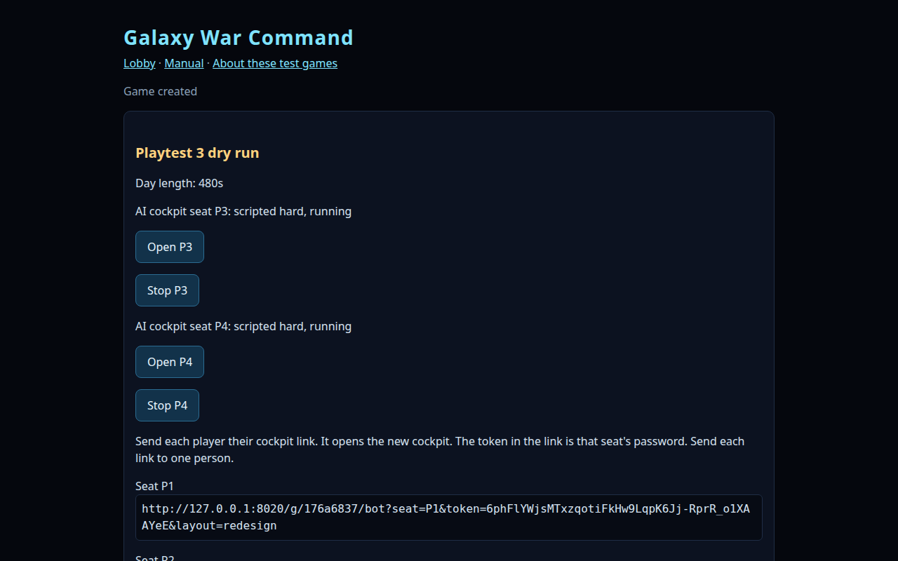
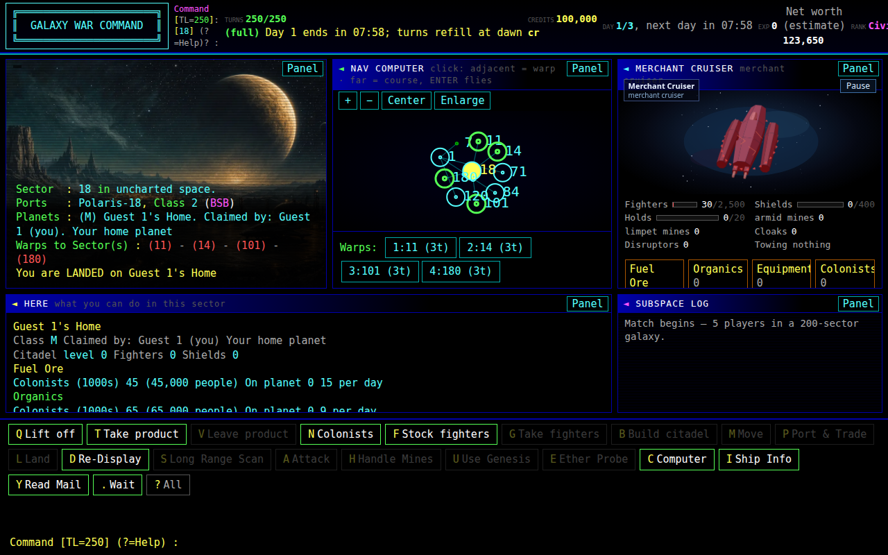
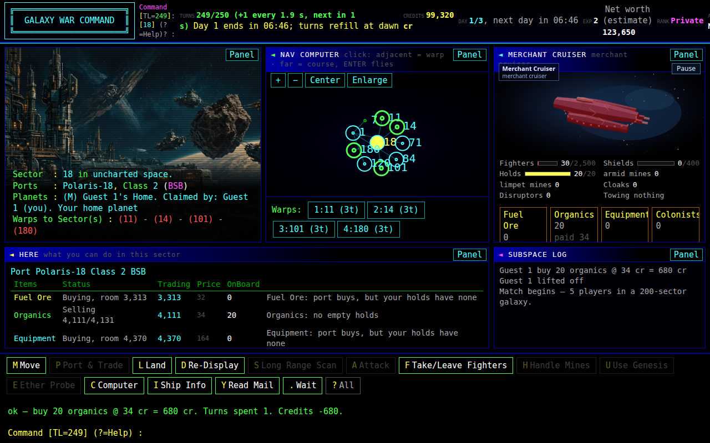
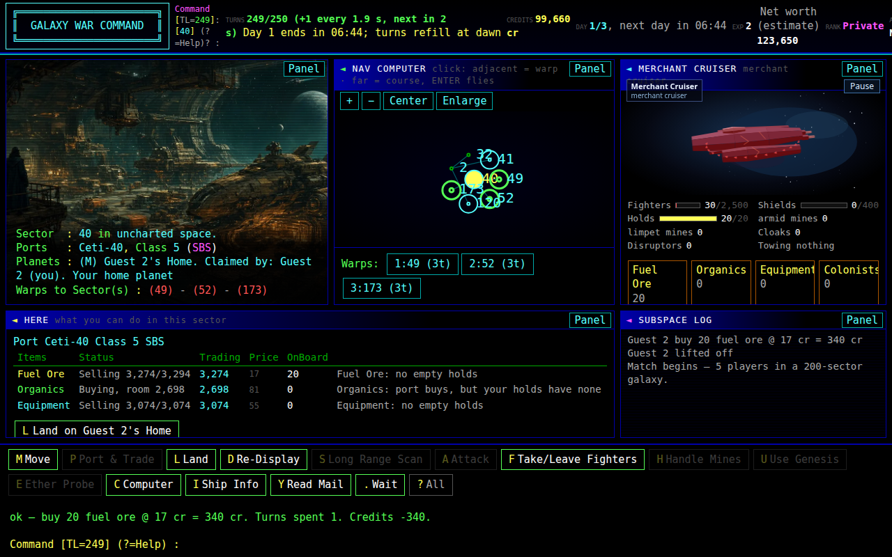
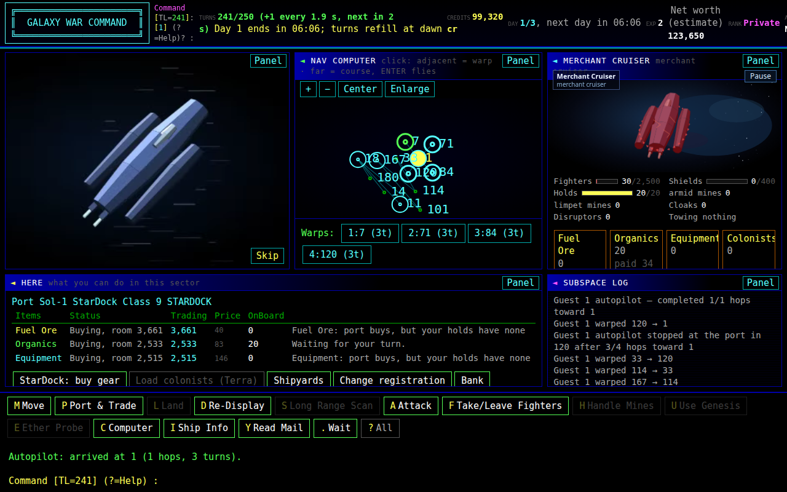
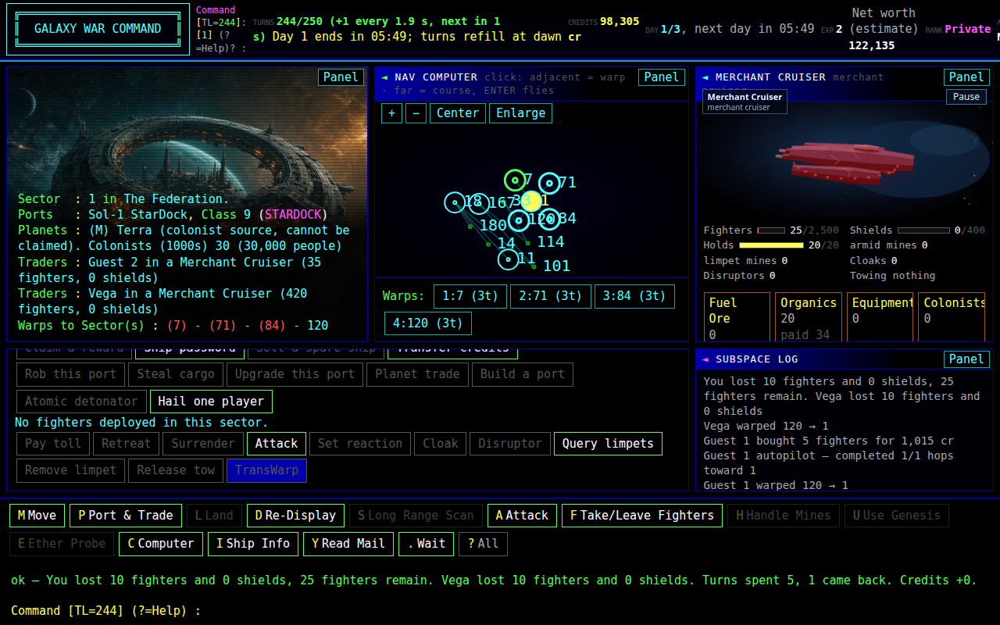
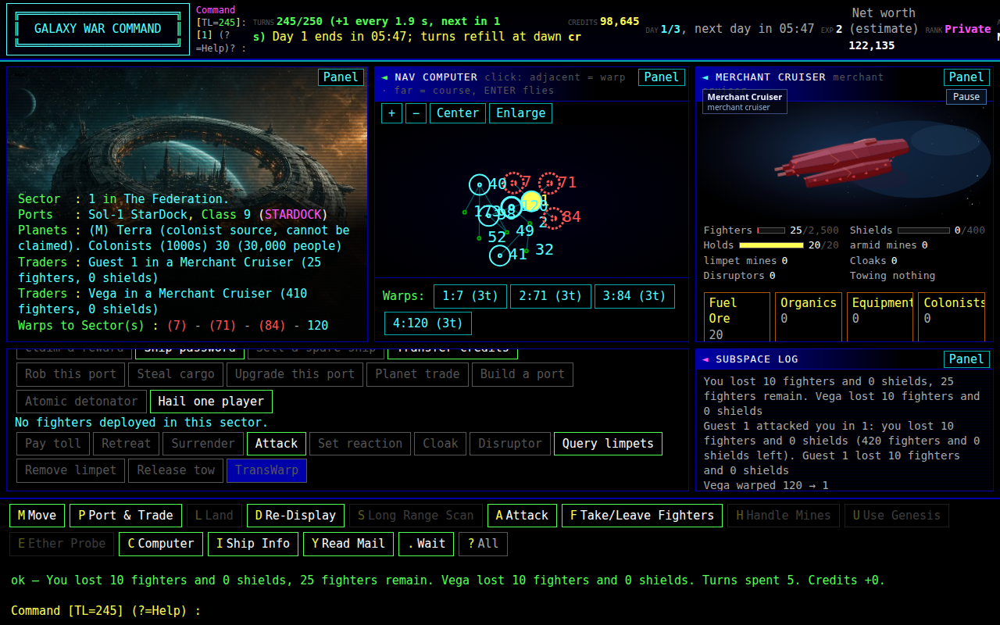
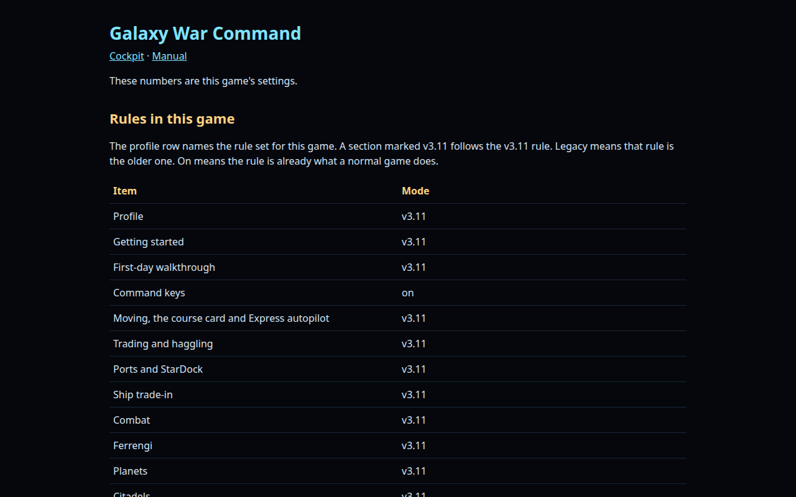
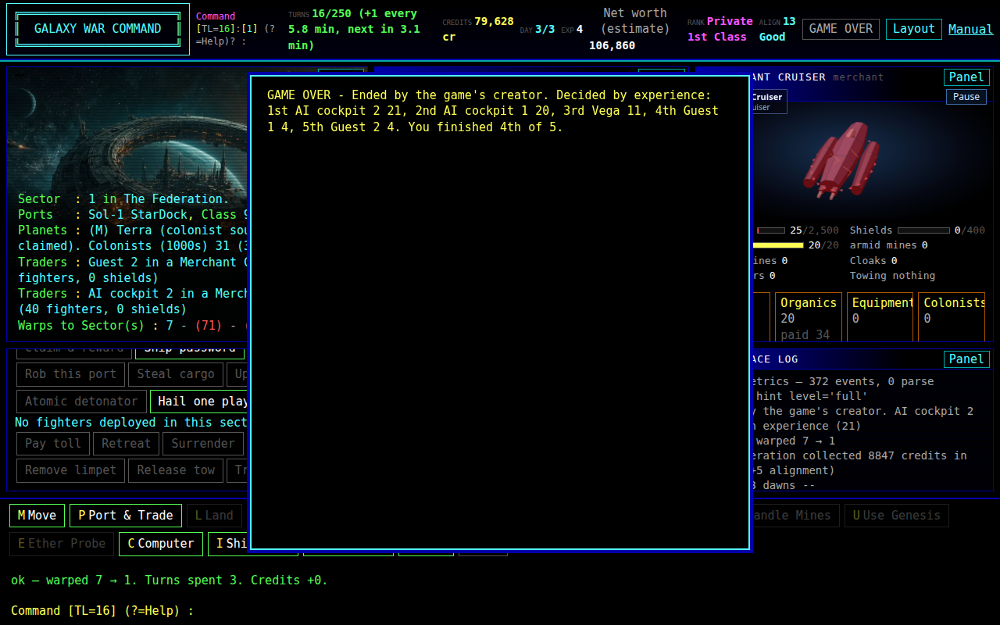

# Playtest 3 dry run

NOTE 155. Checklist: `docs/playtests/PLAYTEST3_READINESS.md` on `track-g-note136` (that file is not on this tip). This run was recorded on `feature/grokbot-player` at `7b831056`, branch `track-g-note155`. The commit is replayed onto `fdd4f11`.

Game `176a6837`, "Playtest 3 dry run". Lobby `127.0.0.1:8020`, worker `8023`. State `/tmp/playtest3-dryrun10` (not in the repo). `V311_PROFILE=v311` came from the form's v3.11 rule set. Shots are in `playtest3-dryrun-v1/`.

## Ports

The lobby refuses 8031–8098, so the open pockets inside that block cannot host it. 8099–8119 are the standing lobby. This run used 8020 for the lobby and 8023 for the game. Both are outside 8031–8037, 8041, 8042, 8045–8049, 8055–8119, and 8099–8119.

## Lineup

The readiness list asks for a full-length 2-day game, one scripted cockpit, one code bot, and one heuristic AI opponent. This note asks for 3 fast days, 2 human browser seats, and 2 AI cockpit seats. The dry run used that request:

- Rule set v3.11, 100,000 credits, Original 250 turns, 200 sectors, 3 days
- Game length fast, day length 480 seconds (the `8m` preset on this lobby only)
- 2 human seats, 1 code bot (Vega), 0 harness AI opponents, Ferrengi on
- 2 scripted hard AI cockpit seats
- Listed, hold the clock until the first player opens a seat

`AI_COCKPIT_SEAT_MODE` stays `legacy` in the tree. The lobby process set it to `tw2002` before `run()`, which is what shows the cockpit checkbox. v3.11 does not turn that switch on by itself.

## What changed for this pass

The engine was left alone. `/bot` (the old page) was left alone. No profile-off guard moved. The scripted-match digests were not re-run; no engine file changed, so they stay at `24863a3d` for seed 250925 and `98a47c8a` for seed 4242.

1. The created page prints one cockpit link per human seat. The link is `seat_link`: `{origin}/g/{id}/bot?seat=…&token=…&layout=redesign`. The origin is the Cloudflare share base when the request arrives on loopback with `X-Forwarded-Host` and `X-Forwarded-Proto: https`. The link is plain text in `code.link` with `user-select: all`, so it can be copied. Opening that link claims the seat for the guest, which is how the creator ends the game. A later resume in the same lobby process keeps the published human token, so the printed link still matches. The raw token stays out of sqlite; the lobby stores the sha256 only.
2. The scripted seat acts only when the chip says `YOUR MOVE`. A click while the chip says `WAITING` was queued and fired on a later turn, so the buy and the sell missed day 1. The runner now waits out `WAITING` and clicks the visible trade button by its exact label. On a known one-hop pair the scripted trader's first two decisions are a buy and then a sell.
3. The worker serves `/g/<id>/manual` and `/g/<id>/static` on its own port. The scripted seat opens the worker directly, and the rewritten page asks for those prefixed paths. `/control` stays closed after the prefix is stripped.

The earlier Guest 1 miss was the dry-run driver. It left the port after one hop and treated the previous result line as a new trade. This run waits until the result line itself says `buy` or `sell`. Both human seats bought on day 1.

The second human fight needs both seats in Vega's sector before either one attacks. The first hit, taken while the other seat is still buying fighters, lets Vega leave before the second seat presses A. This run held the second seat until both had fighters, then seat 1 struck and seat 2 struck on the following turn, while the scheduler was still waiting on seat 2.

## Checklist

| Item | Result | Evidence |
| --- | --- | --- |
| Disclaimer, "I understand" | Pass | `playtest3-dryrun-v1/01-disclaimer.png` |
| New-game lineup above | Pass | `02b-form-filled.png`. Created page: "Day length: 480s". |
| Created page: scripted cockpit running | Pass | "AI cockpit seat P3: scripted hard, running" and the same for P4. `03-created.png` |
| Created page: per-seat cockpit link, token, `layout=redesign`, copyable, https when sharing is on | Pass | The scratch lobby has no tunnel, so the page printed `http://127.0.0.1:8020/g/176a6837/bot?seat=P1&token=…&layout=redesign` and the same for P2, under "Send each player their cockpit link." The link is a text block. The same builder, given `X-Forwarded-Host: blue-pond.trycloudflare.com` and `X-Forwarded-Proto: https`, prints `https://blue-pond.trycloudflare.com/g/{id}/bot?seat=P1&token=…&layout=redesign`. `tests/test_selfhost_beta_v1.py::test_created_page_prints_one_copyable_cockpit_link_per_seat` checks that URL, `user-select:all`, and that opening P1's link claims P1. `03-created.png` |
| Both seats land at home, 100,000 cr, 250/250, YOUR MOVE, day line | Pass | P1 sector 18, "You are LANDED on Guest 1's Home", `TURNS250/250 (full)`, "Day 1 ends in 07:58", YOUR MOVE, 100,000 cr. `04-cockpit-p1.png`. P2 sector 40, Guest 2's Home, same pocket; the first paint was WAITING until P1 moved. `04-cockpit-p2.png`. The turn line and the day line sit in the header stat, and both were readable at 1280. |
| Q, lift off, "ok — lifted off." | Pass | Both seats: "ok — lifted off. Turns spent 1. Credits +0." `06-liftoff-P1.png`, `06-liftoff-P2.png` |
| Trade at a BUY or SELL port | Pass | P1 at sector 18: "ok — buy 20 organics @ 34 cr = 680 cr." Event: "Guest 1 buy 20 organics @ 34cr = 680cr". `07-trade-P1.png`. P2 at sector 40: "ok — buy 20 fuel ore @ 17 cr = 340 cr." Event: "Guest 2 buy 20 fuel_ore @ 17cr = 340cr". `07-trade-P2.png` |
| Warp one hop, clip, turn drop | Pass | P1 `1:11 (3t)`, clip `merchant_cruiser.chase.10`, "ok — warped 18 → 11. Turns spent 3." `08-warp-clip-P1.png`. P2 `1:49 (3t)`, clip `merchant_cruiser.gate.06`, "ok — warped 40 → 49. Turns spent 3." `08-warp-clip-P2.png` |
| StarDock, Class 9, Terra unclaimable | Pass | Both reached sector 1. "Sol-1 StarDock, Class 9 (STARDOCK)". "Terra (colonist source, cannot be claimed)." `09-stardock-P1.png` |
| Buy fighters, "ok — bought … fighters" | Pass | Both: "ok — bought 5 fighters for 1,015 cr. Turns spent 0." `10-fighters-P1.png`, `10-fighters-P2.png` |
| Fight the code bot | Pass | Both seats sent 10 fighters at Vega in sector 1. P1: "You lost 10 fighters and 0 shields, 25 fighters remain. Vega lost 10 fighters and 0 shields." P2: the same line, Vega then on 410 fighters. Events: "Combat in 1: Guest 1 sent 10 fighters, lost 10; Vega lost 0 shields and 10 fighters" and the same for Guest 2. `11-combat-P1.png`, `11-combat-P2.png` |
| Manual is the v3.11 player manual | Pass | Both seats opened Manual from the header. Title "Galaxy War Command", "These numbers are this game's settings", Profile row v3.11. `12-manual-P1.png` |
| Manual includes the full-length 24-hour paragraph | N/A | This was a fast game (480-second day). That paragraph is printed for a full-length game. The fast game's manual does not include it, and the manual renderer was left unchanged. |
| Layout: larger font, then Reset layout | Pass | Both seats: computed `--cockpit-font` was `17px`, then `default` after Reset layout. `13-layout-P1.png`, `14-layout-reset-P1.png` |
| Day 2, each seat acts | Pass | "Day 2 dawns". P1 "ok — warped 1 → 7. Turns spent 3, 1 came back." clip `merchant_cruiser.side.09`. P2 "ok — warped 1 → 7. Turns spent 3." clip `merchant_cruiser.headon.03`. `08-warp-P1-day2.png`, `08-warp-P2-day2.png` |
| Day 3, each seat acts | Pass | "Day 3 dawns". Header DAY 3/3. P1 "ok — warped 7 → 1. Turns spent 3." clip `merchant_cruiser.side.05`. P2 "ok — warped 7 → 1. Turns spent 3, 1 came back." clip `merchant_cruiser.top.08`. `08-warp-P1-day3.png` |
| Scripted AI seats trade on day 1 | Pass | While the screen still said day 1, P3 clicked `step 10 BUY 20` and `step 13 SELL 20` (and a second pair at steps 16 and 19). P4 clicked `step 9 BUY 20` and `step 12 SELL 20` (and a second pair at steps 15 and 18). Events before dawn: "AI cockpit 1 buy 20 organics @ 29cr = 580cr" and "AI cockpit 1 sell 20 organics @ 62cr = 1240cr (+660cr profit)". The same buy and sell for AI cockpit 2. |
| Creator ends the game | Pass | `?` menu, End game for everyone, confirm. Header chip GAME OVER. Panel on P1: "GAME OVER - Ended by the game's creator. Decided by experience: 1st AI cockpit 2 21, 2nd AI cockpit 1 20, 3rd Vega 11, 4th Guest 1 4, 5th Guest 2 4. You finished 4th of 5." Match event: "Ended by the game's creator. AI cockpit 2 leads on experience (21)". Scores P4 21, P3 20, Vega 11, Guest 1 4, Guest 2 4. `16-game-over-p1.png`, `16-game-over-p2.png` |

## Shots

