# Playtest 3 readiness

This is the checklist for the next real beta. A practice run already walked the whole path: the creator made the game in the lobby, two people joined through their https seat links, both played day 1 and day 2 in the new cockpit, and the creator ended the game. The pictures at the bottom are from that run.

The practice run used a free test port and a pretend https tunnel, the same shape as the Cloudflare link. Your lobby stays on 8099. Start it the way you already do, then open the share window and leave it open:

```
powershell -ExecutionPolicy Bypass -File scripts\share_beta_cloudflare.ps1
```

On Mac or Linux: `sh scripts/share_beta_cloudflare.sh`

The window prints the public `https://` address. Open that. Accept the disclaimer the first time it asks.

## Make the game

On New game, use this lineup. A short test is enough. A longer game uses the same switches.

- Game name: anything you like
- Rule set: v3.11 (recommended)
- Starting credits: 100,000 for a short test, or Original (300 cr) when you want the real pocket
- Turns per day: Original (250). Full-length replaces this with the daily cap below.
- Universe size: 200 is enough to find a port, StarDock, and the code bot
- Max days: 2, so you can see a dawn. A real game can be longer.
- Game length: Full-length. That sets a 24-hour day. On a game of 30 days or fewer the daily cap stays 250 turns. Past 30 days the cap drops so the whole game stays near 7,500 turns, and it never goes below 50.
- Day length: Real time, 24 h. Choosing Full-length selects this for you.
- Open human seats: 2
- Code bots: 1
- AI opponents: 1, brain Heuristic (free)
- Ferrengi: On
- AI cockpit seat: checked, provider Scripted (no key)
- Who can find it: Listed in the lobby
- Hold the clock until the first player opens a seat: leave this checked

Press Create game.

The next page names the game, says it is full-length, and says the AI cockpit seat is scripted and running. That seat plays by itself in the new cockpit. You do not send it a link. The page also says how many heuristic AI seats there are. Those are not join links.

## Send the two seats

Under "Send each player their cockpit link" there is one link per human seat. Each one looks like this:

```
https://<the-words>.trycloudflare.com/g/<game-id>/bot?seat=P1&token=<token>&layout=redesign
```

`layout=redesign` is the new cockpit. `token` is that seat's password. Send P1's link to one person and P2's link to the other person. Each person opens their own link, accepts the disclaimer if it is their first visit, and lands in the cockpit.

The older "Lobby invite" lines are for the lobby seat page. This playtest uses the cockpit links.

You sit in the game by opening your own seat link. That is the seat that can end the game.

## Day 1, both cockpits

You start landed on your home planet, with 100,000 credits if you picked that pocket, day 1 of 2, and the yellow line "YOUR MOVE". The header also shows "Turns left today: 250 of 250" and "Day 1 ends in …" on their own lines under the command bar.

Do these on both seats. Press the key, or click the button with that letter.

- [ ] Q, Lift off. The line reads "ok — lifted off." Warp and trade stay closed until you lift off.
- [ ] Trade at a port that is buying or selling. The line starts with "ok". Home and StarDock often have nothing in your holds to sell, so warp to a neighbor and look for a BUY or SELL button.
- [ ] Warp one hop. A short clip of your ship plays, then the log says warped and the turn count drops.
- [ ] Reach StarDock. Sector 1 reads "Sol-1 StarDock, Class 9 (STARDOCK)". Terra is there and cannot be claimed.
- [ ] Buy fighters at StarDock. The line reads "ok — bought … fighters".
- [ ] Fight the code bot while you share its sector. Press A, pick the trader whose name ends with "(code bot)", and attack. In the practice run the bot was Vega. The line names what you lost and what the bot lost.
- [ ] Open Manual in the header. The page is the player manual for this game, profile v3.11, and it includes the full-length paragraph (250 turns on a 30-day game, a lower cap on a longer game, a 24-hour day).
- [ ] Open Layout. Make the font larger and close the menu. The cockpit keeps that size. Open Layout again and press Reset layout. The font returns to the normal size.

Pass the turn with the period key when you are done, so the other seat can move.

## Day 2

A full-length day is 24 hours. In a game you share with friends, leave the clock alone and come back the next day.

The practice run moved the server's day mark with a private switch, `PLAYTEST_CLOCK_NUDGE_MODE=on`, so dawn arrived during the test. That switch is off in a normal game. Setting it to `1` leaves it off. Leave it unset when you want a real 24-hour day.

After dawn the header reads day 2 of 2, "Day 2 dawns", and "Day 2 ends in …". Take one more action on each seat.

- [ ] Both cockpits show day 2
- [ ] Each seat takes one more action

## End the game

The creator, in their own seat, opens the `?` menu and chooses End game for everyone, then confirms.

- [ ] Both cockpits show "GAME OVER - Ended by the game's creator." and the experience rankings

## What the practice run already showed

Both seats did every day-1 step. The scripted AI cockpit played on its own. The server then reached day 2, and each person acted once more. The creator ended it.

| Step | What the screen said |
| --- | --- |
| Lift off | ok — lifted off. Turns spent 1. |
| Warp | Clip `merchant_cruiser.headon.07` on seat 1, `merchant_cruiser.side.09` on seat 2. "ok — warped …" |
| Trade | Seat 1 sold 20 organics at 66 cr for 1,320 cr. Seat 2 sold 20 equipment at 124 cr for 2,480 cr. |
| StarDock | Sol-1 StarDock, Class 9 (STARDOCK), sector 1 |
| Fighters | ok — bought 5 fighters for 1,015 cr. |
| Combat | You lost 30 fighters and 0 shields, 0 fighters remain. Vega lost 30 fighters and 0 shields. Turns spent 5. |
| Day 2 | Day 2 dawns. Turns come back a little at a time; you have 229 of 250. |
| End | GAME OVER - Ended by the game's creator. Decided by experience: 1st AI (heuristic) 11, 2nd Guest 2 9, 3rd Guest 1 6, 4th AI cockpit 5, 5th Vega 1. You finished 3rd of 5. |

## Fixes in this build

- The invite form keeps the invite password, so a friend who follows a lobby invite can take that seat.
- Manual, opened from inside a running game, shows the player manual, including the full-length paragraph.
- The created page prints each human's https cockpit link, token included. Opening your own link sits you in that seat, which is how you end the game from the cockpit.
- The scripted AI cockpit loads its screen on the game's own address, including the pictures and the script, so it can play.
- "Turns left today" and "Day N ends in" sit on their own lines under the command bar, so a 1280-wide window can read them.
- With the playtest day switch on, moving the day mark takes effect within a second. With the switch off, the wait is the same length it already was.

The old `/bot` page is unchanged. The day-mark switch defaults to off.

## Shots

- `playtest3-readiness-v1/01-disclaimer.png` — first visit, "I understand"
- `playtest3-readiness-v1/02-new-game.png` — AI cockpit seat checked, Scripted (no key)
- `playtest3-readiness-v1/03-created-links.png` — full-length line, scripted cockpit running, two https token links
- `playtest3-readiness-v1/04-cockpit-p1.png` — landed at home, 100,000 cr, Turns left today: 250 of 250
- `playtest3-readiness-v1/06-trade-P1.png` — sold organics, the ok line
- `playtest3-readiness-v1/07-warp-P1.png` — the warp clip, then "ok — warped"
- `playtest3-readiness-v1/08-stardock-P1.png` — Sol-1 StarDock, Class 9
- `playtest3-readiness-v1/09-combat-P1.png` — the fight with Vega
- `playtest3-readiness-v1/10-manual.png` — the in-game manual, profile v3.11
- `playtest3-readiness-v1/11-layout-saved.png` — the layout menu
- `playtest3-readiness-v1/12-layout-reset.png` — after Reset layout
- `playtest3-readiness-v1/13-day-2.png` — Day 2 dawns, 2/2
- `playtest3-readiness-v1/14-game-over.png` — Ended by the game's creator

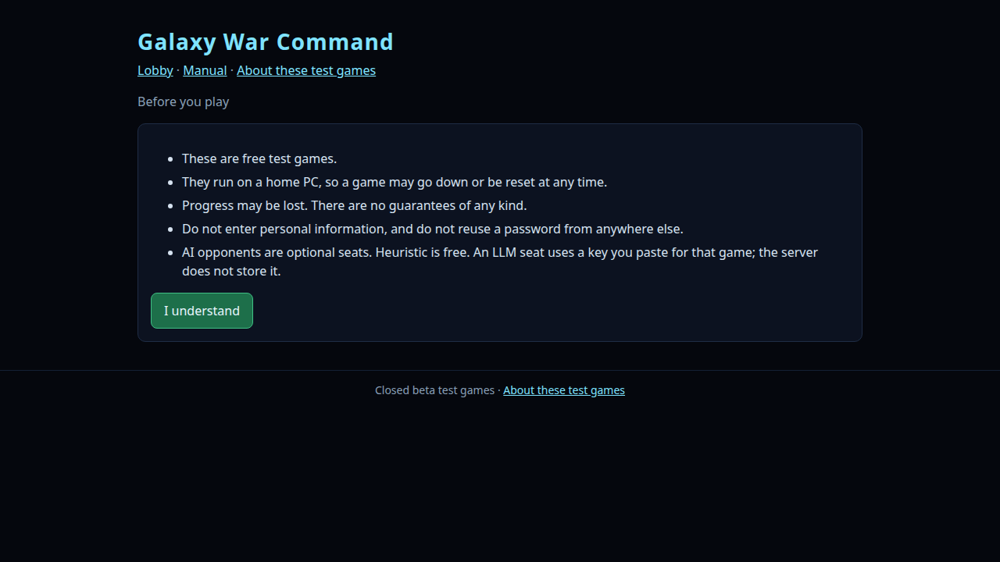

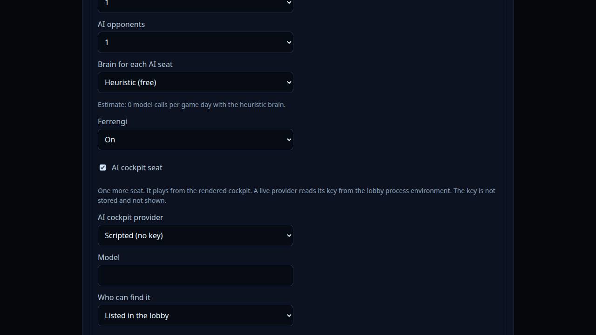

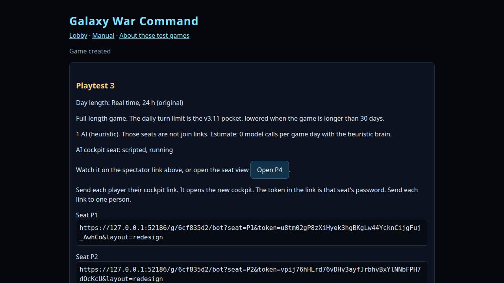

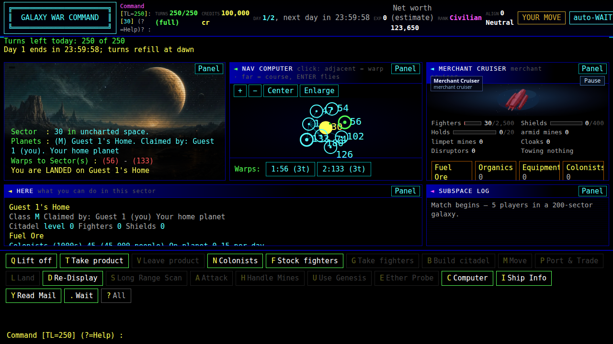

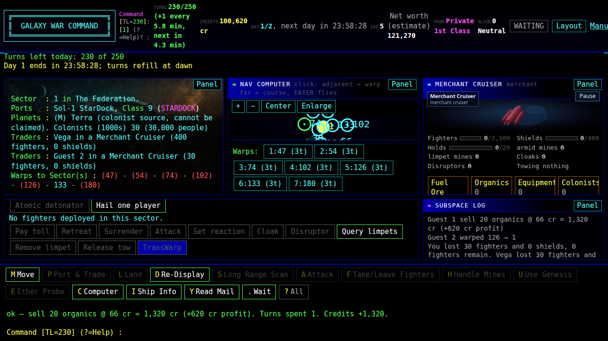

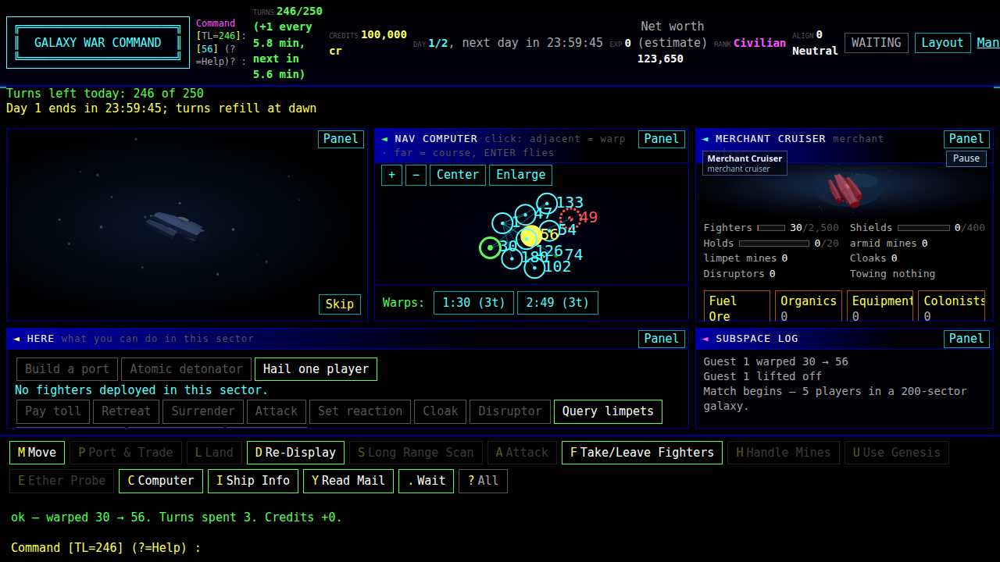

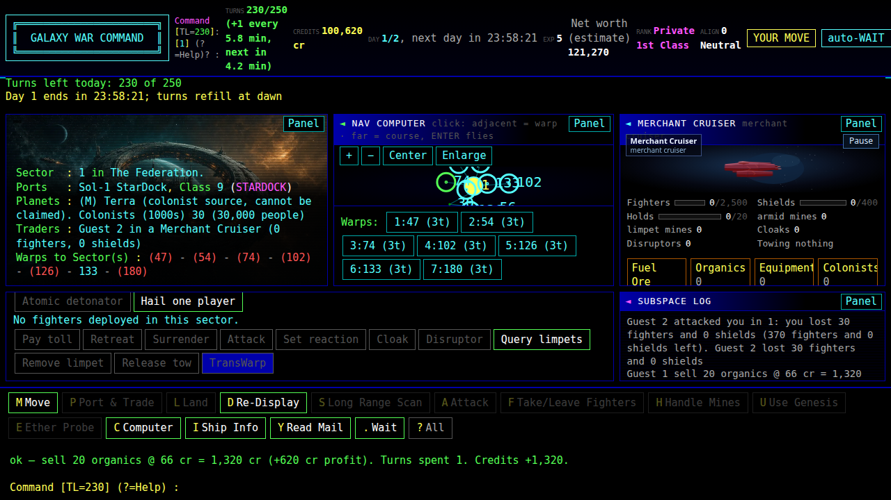

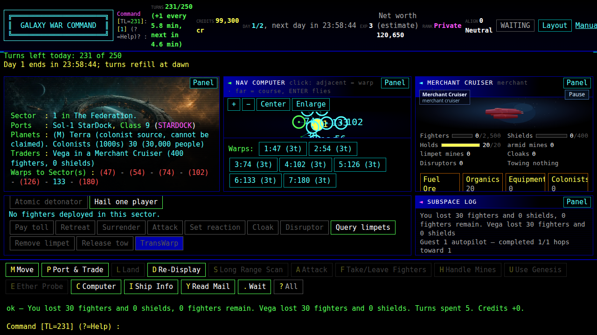

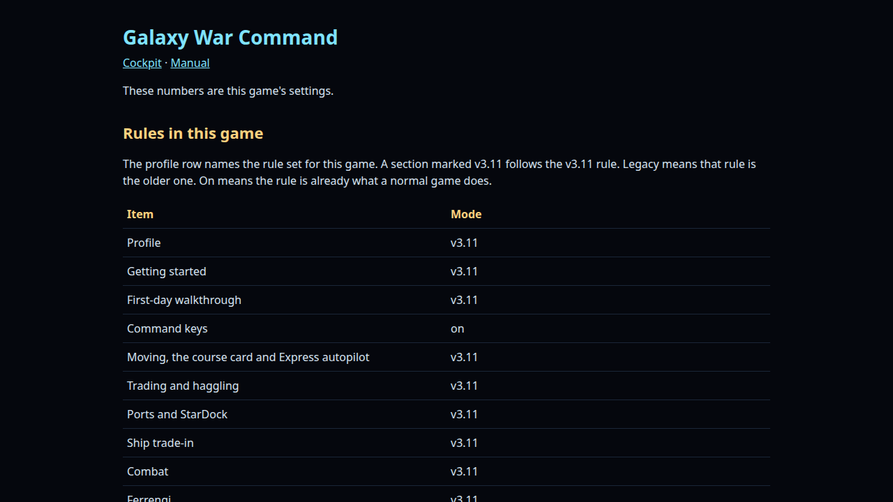

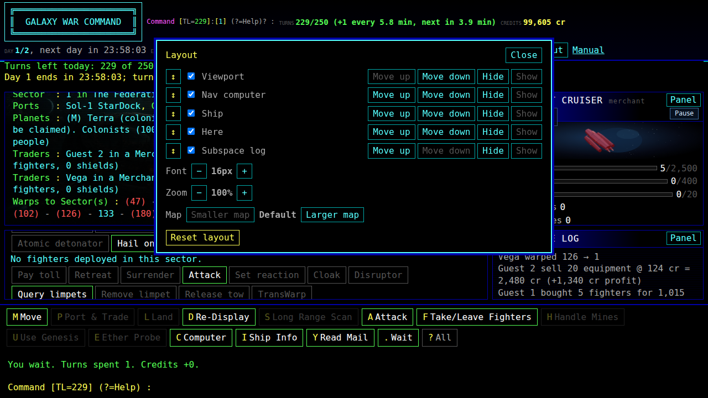

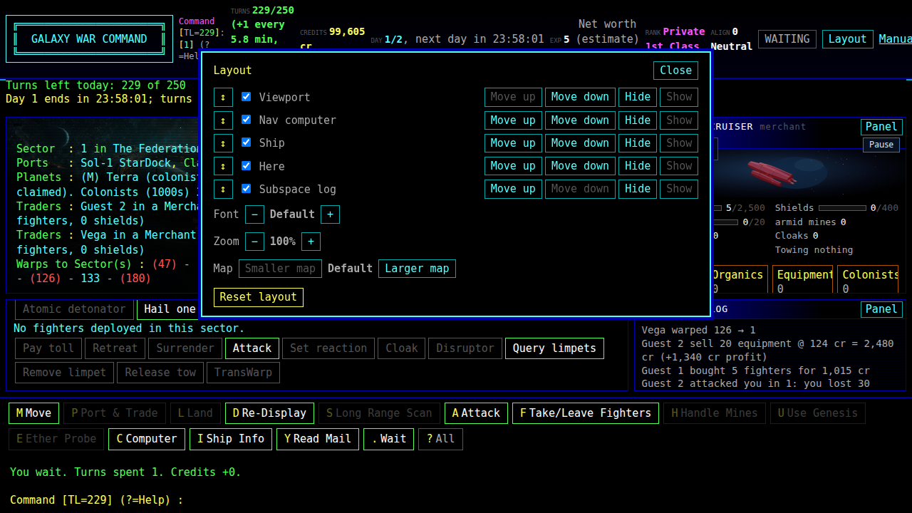

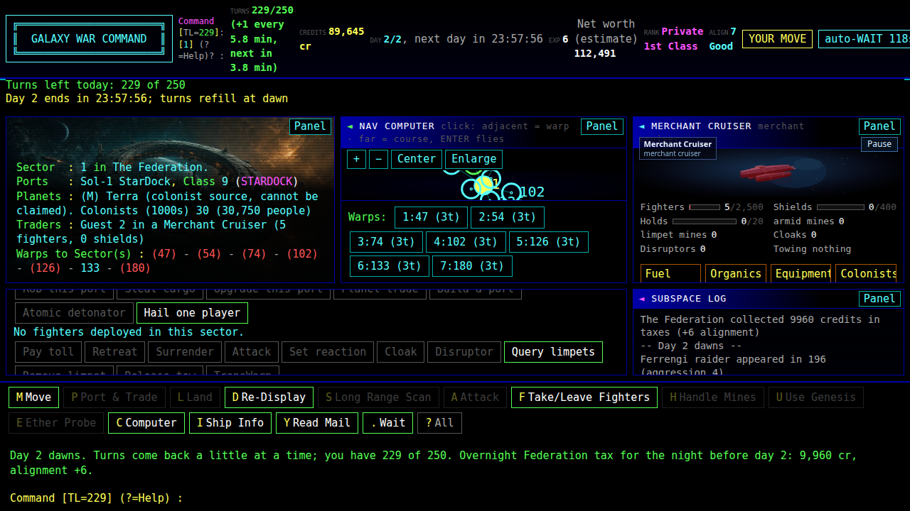

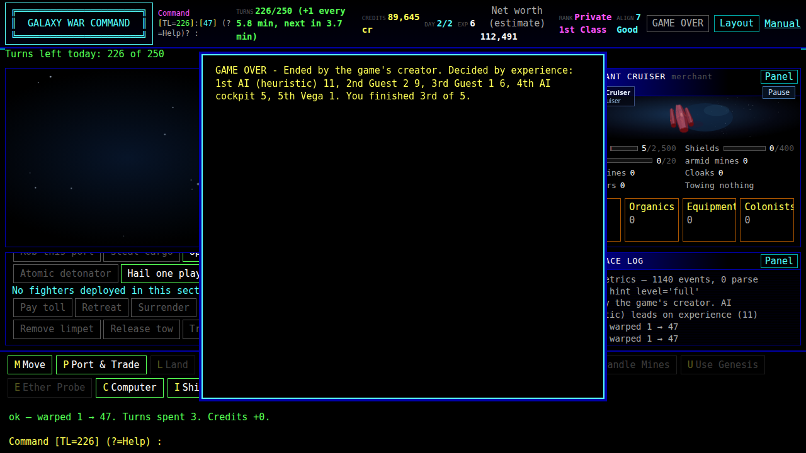
